# **1.两数之和**

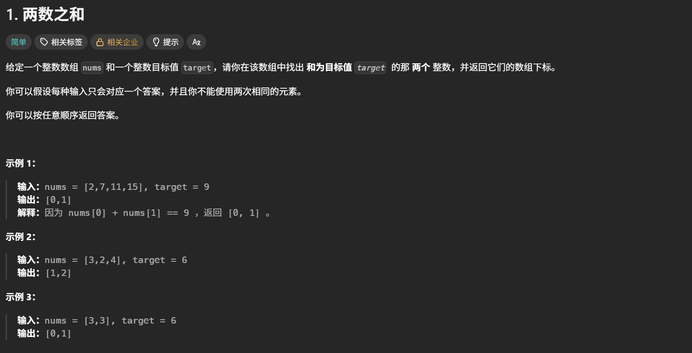

## 我的解法 暴力求解

```python
class Solution:
    def twoSum(self, nums: list[int], target: int) -> list[int]:
        n = len(nums)
        for i in range(n):
            for j in range(i + 1 , n):
                    res = nums[i] + nums[j]
                    if res == target:
                        return [i, j]
        return [] 
```
## 哈希表求解
由于采用两个for循环时的时间复杂度是$\color{#ff0000}{O(N^2)}$空间复杂度是$\color{#ff0000}{O(1)}$\
因此可以采用哈希表用复杂空间换简单时间\
哈希表其实有一个$\color{#ff0000}{记忆}$功能，在暴力求解的时候中的第二个for循环会遍历多次重复的值所以通过速度慢了\
这个容器就叫做哈希表\
例如：\
2  -> 0\
7  -> 1\
11 -> 2\
15 -> 3

```python
class Solution_1:
    def twoSum(self, nums: list[int], target: int) -> list[int]:
        # 在python中哈希表的数据结构是字典 cache -> 缓存
        cache = {} # 哈希表
        for i, item in enumerate(nums):
            cache[item] = i # 制表
        for i, item in enumerate(nums):
            other = target - item
            if other in cache and cache[other] != i:
                return [i, cache[other]] 
        return []

# 边遍历边判断 因此只需要一个for循环
class Solution_2:
    def twoSum(self, nums: list[int], target: int) -> list[int]:
        cache = {} # 哈希表
        for i, item in enumerate(nums):
            other = target - item
            if other in cache:
                return [i, cache[other]] 
            cache[item] = i # 记忆存储
        return []
```

## $\color{#ff0000}{什么时候要用哈希表？}$
当你$\color{#ff0000}{重复}$的去遍历一个数组时可以采用并且可以边遍历边记录值\
或者是当你需要$\color{#ff0000}{记忆}$一个数据的时候采用，有点类似与控制里面的$\color{#ff0000}{info}$

# **167.两数之和Ⅱ（$\color{#ff0000}{有序，两数，唯一解 -> 考虑双指针}$）**
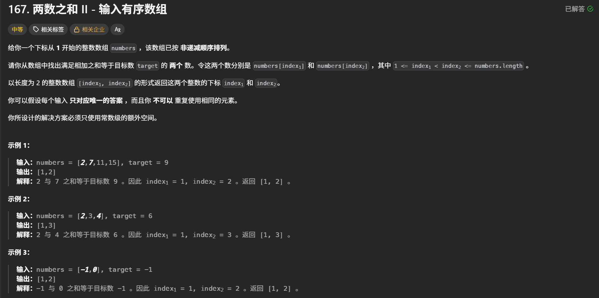

## 我的解题方法 哈希表

```python
class Solution:
    def twoSum(self, numbers: list[int], target: int) -> list[int]:
        cache = {}
        for i, item in enumerate(numbers):
            other = target - item
            if other in cache:
                return [min(i + 1, cache[other] + 1),  max(i + 1, cache[other] + 1)]
            cache[item] = i
        return []
```

由于数组的前提是有序的，$\color{#ff0000}{非递减顺序排列}$，所以 i 一定是大的 cache[other]一定是小的\
因此不需要再去判断大小了，可以直接写了

```python
class Solution:
    def twoSum(self, numbers: list[int], target: int) -> list[int]:
        cache = {}
        for i, item in enumerate(numbers):
            other = target - item
            if other in cache:
                return [cache[other] + 1, i + 1]
            cache[item] = i
        return []
```

$\color{#ff0000}{有问题你所设计的解决方案必须只使用常数级的额外空间}$
哈希表并不是常量空间，他的$\color{#ff0000}{空间复杂度是O(N)}$ 

## 正确方法双指针
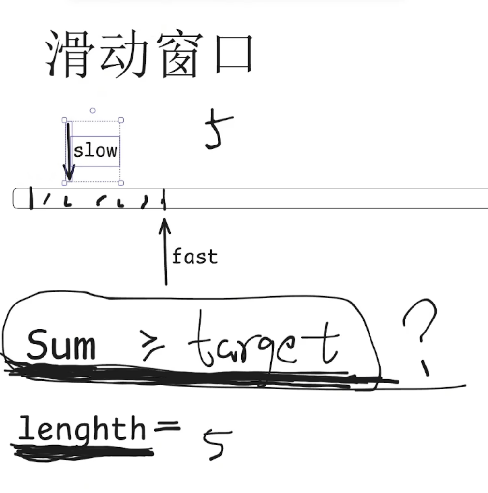

```python
class Solution:
    def twoSum(self, numbers: list[int], target: int) -> list[int]:
        left = 0
        right = len(numbers) - 1
        # 一个好方法：在使用while循环的时候先写True让循环跑起来，可以反向思考循环什么时候结束，然后取反就得到了进入循环的条件
        while not left == right: 
            if numbers[left] + numbers [right] > target:
                right -= 1
            elif numbers[left] + numbers [right] < target:
                left += 1
            elif numbers[left] + numbers [right] == target:
                return[left + 1, right + 1]
        return []
```

# **209.长度最小的子数组**
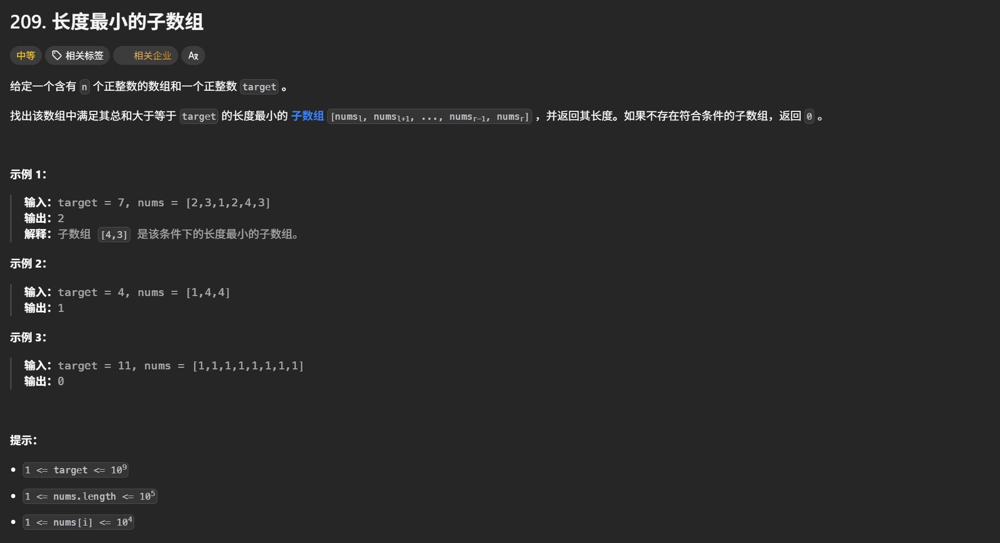

## 暴力求解 $\color{#ff0000}{O(N^2)}$
```python
class Solution:
    def minSubArrayLen(self, s: int, nums: List[int]) -> int:
        if not nums:
            return 0
        
        n = len(nums)
        ans = n + 1
        for i in range(n):
            total = 0
            for j in range(i, n):
                total += nums[j]
                if total >= s:
                    ans = min(ans, j - i + 1)
                    break
        
        return 0 if ans == n + 1 else ans
```

## 滑动窗口/快慢指针 $\color{#ff0000}{O(N)}$
```python
class Solution:
    def minSubArrayLen(self, target: int, nums: list[int]) -> int:
        slow = 0 # 慢指针
        fast = 0 # 快指针
        my_sum = 0
        min_len = float('inf')

        while fast < len(nums):  # 注意小于号不能有等于 等于缩索引不了数组
            my_sum += nums[fast]

            while my_sum >= target:  # 注意这里可能会写成if 不要忘记slow是要一直往前更新的写成if就只会更新一次
                min_len = min(min_len, fast - slow + 1)
                my_sum -= nums[slow]
                slow += 1
            
            fast += 1
        
        if min_len == float('inf'):
            return 0
        else:
            return min_len
```
$\color{#ff0000}{当不满足条件的时候，快指针往前探路；当满足条件的时候慢指针，开始起步}$\
如果题目中包含$\color{#ff0000}{连续、子数组}$ 等就要想到$\color{#ff0000}{滑动窗口，快慢指针}$ \
还有一点就是这个题目中的要求是正整数，所以你区间增大sum才会增大如果不是这样，那么你的快指针将没有什么意义

# **3.无重复字符的最长子串**
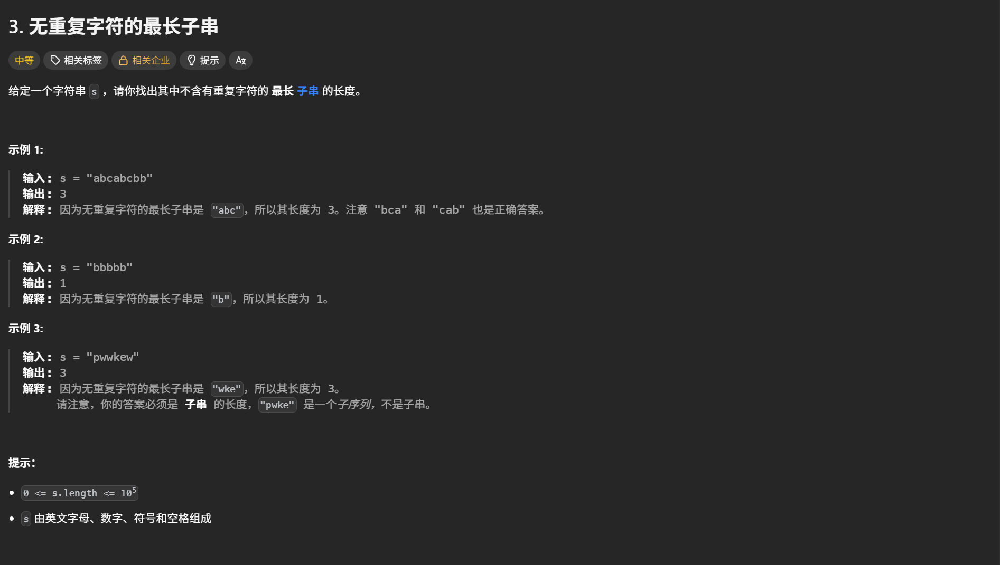

## 滑动窗口/快慢指针 $\color{#ff0000}{O(N)}$

$\color{#ff0000}{看见无重复字符就可以想到set}$

```python
class Solution:
    def lengthOfLongestSubstring(self, s: str) -> int:
            left = 0 
            right = 0
            my_set = set()
            max_len = 0

            while right < len(s): 

                if s[right] in my_set: # 如果当前记录过
                    my_set.remove(s[left])
                    left += 1
                else:                  # 如果当前没记录过
                    my_set.add(s[right])
                    max_len = max(max_len, len(my_set))
                    right += 1

            return max_len
```

$\color{#ff0000}{或者是字典或者哈希表}$
```python
class Solution:
    def lengthOfLongestSubstring(self, s: str) -> int:
            left = 0 
            Pos = {}
            max_len = 0
            
            for right, char in enumerate(s):

                if char in Pos:
                    left = max(left, Pos[char] + 1)
                Pos[char] = right
                max_len = max(max_len, right - left + 1)

            return max_len
```

类似于滑动窗口由于是连续可以直接截断并且找最长
```python
class Solution:
   def lengthOfLongestSubstring(self, s: str) -> int:
       sub = ""
       res = 0
       for ch in s:
           if ch in sub:
               # 找到重复位置，把重复点之前部分截掉
               idx = sub.index(ch)
               sub = sub[idx + 1:]
           sub += ch
           res = max(res, len(sub))
       return res
```
# 26.删除有序数组中的重复项
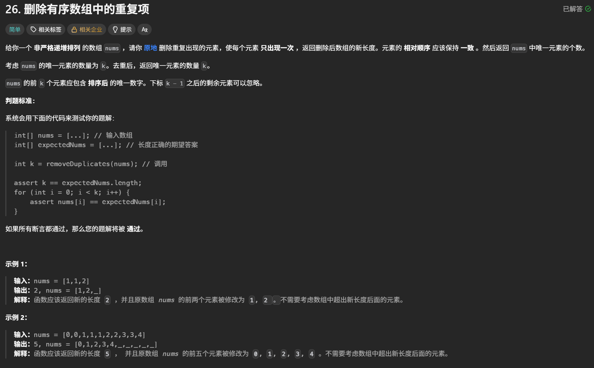

题目中一提到重复想到$\color{#ff0000}{哈希表或者集合}$是正确的\
但是题目要求原地修改就应该想到$\color{#ff0000}{读写指针}$也是快慢指针的一种，同时$\color{#ff0000}{空间复杂度为常数项}$也是提示词

## 算法图解
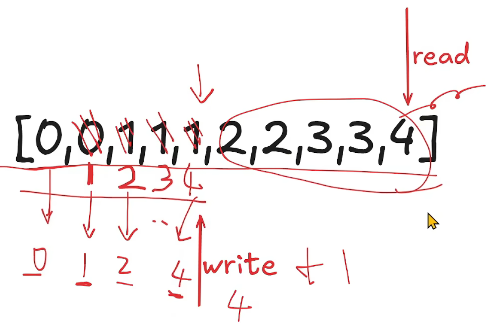

```python
class Solution:
    def removeDuplicates(self, nums: list[int]) -> int:
        read = 0 
        write = 0 
        while read < len(nums):
            if nums[read] == nums[write]:
                read += 1
            else:
                write += 1
                nums[write] = nums[read]
        return write + 1
```

# 704.二分查找$\color{#ff0000}{O(logN)}$
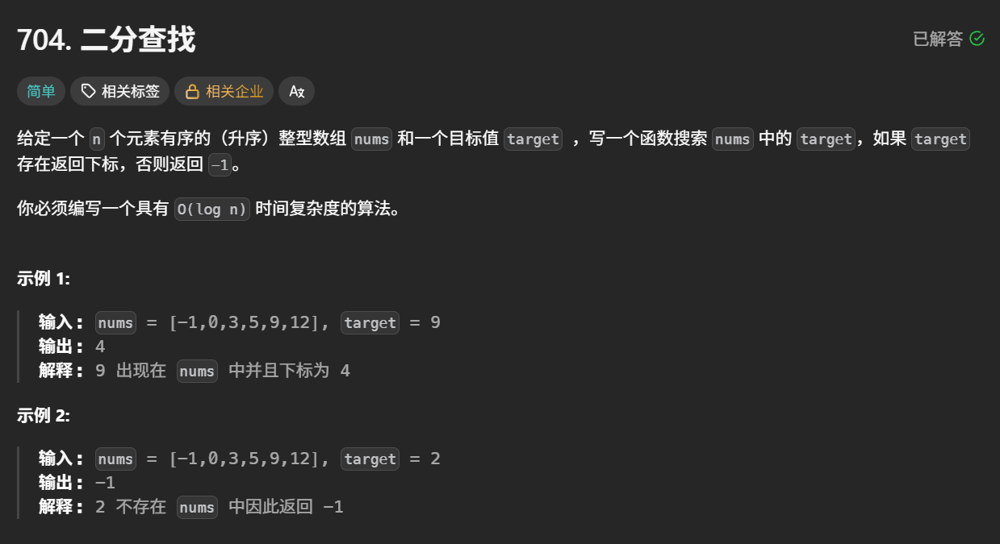

题目中一提到$\color{#ff0000}{有序、查找}$想到$\color{#ff0000}{二分查找}$\
这个题目要注意的是$\color{#ff0000}{边界条件}$\
对于大部分的代码来讲习惯用$\color{#ff0000}{左闭右开}$

## 算法图解
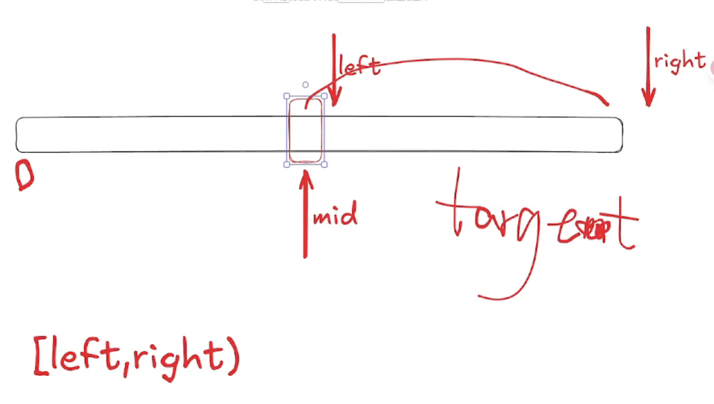

```python
class Solution:
    def search(self, nums: list[int], target: int) -> int:
        left = 0
        right = len(nums)
        mid = (left + right) // 2 # 这是向左取整
        while left < right: # 由于你定义的区间是[left, right)你必须left < right
            if nums[mid] == target:
                return mid
            elif nums[mid] < target:
                # 这里加一的原因是：首先你的区间是左闭右开
                # 由于你中了elif之后你一定已经判断完成mid这个位置的数据了，因此你不要重复判断就需要+1移位
                left = mid + 1    
            elif nums[mid] > target:
                # 这里没有加一的原因是：首先你的区间是左闭右开
                # 由于你中了elif之后你已经判断完成mid这个位置的数据了，但是右边是开区间因此取不到不用加一了
                right = mid 
            mid = (left + right) // 2 # 不要忘记更新mid
        return -1
```

# 59.螺旋矩阵Ⅱ
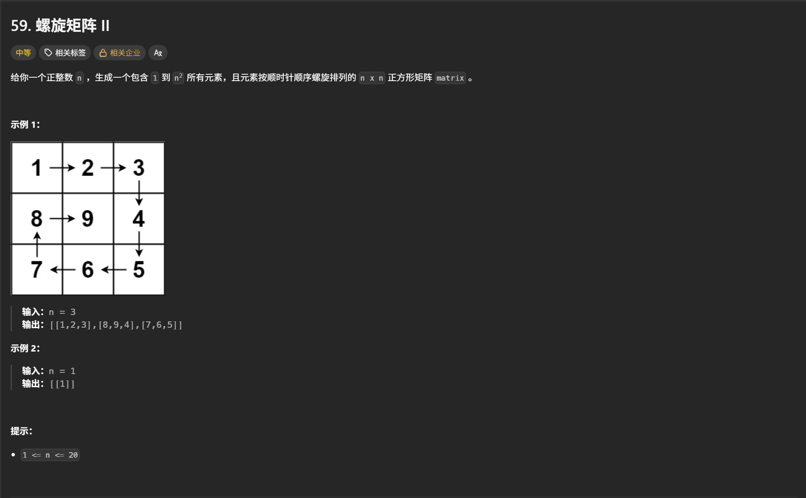

螺旋矩阵这类题是模拟题，即为所见即所得但是这种题很恼火的是$\color{#ff0000}{扣边界条件以及细节}$扣边界条件以及细节记得$\color{#ff0000}{debug}$\
主要考察的是对代码边界能力，记住区间设置原则$\color{#ff0000}{左闭右开}$

## 常规解法

就按照题设的要求来\
思路就是写右->下->左->上，四个for循环再用一个while去填满不同的层
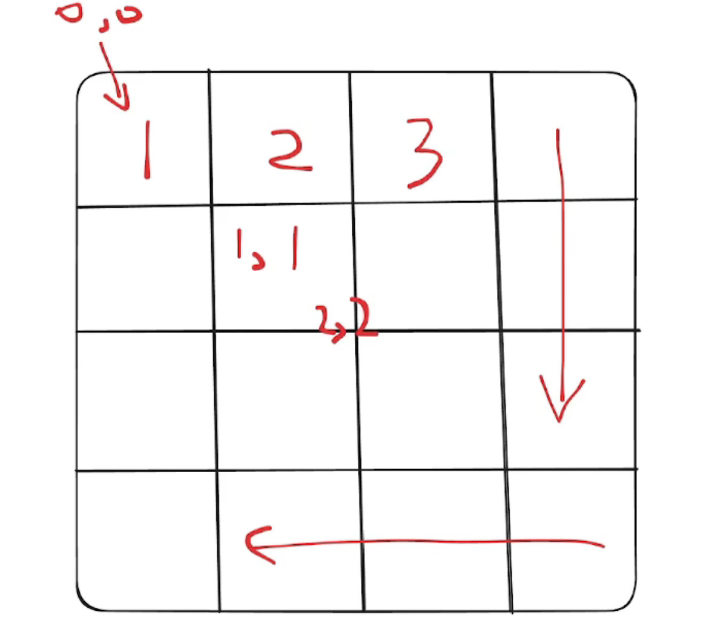

```python
class Solution:
    def generateMatrix(self, n: int) -> list[list[int]]:
        matrix = [[0] * n for _ in range(n)]             # 申请一个nxn的zeros矩阵
        count = 1                                        # 准备填入的数字从1开始的
        start_index = 0                                  # 循环起始点，0 -> (0,0), 1 -> (1,1) ...
        # while范围的确定 如果用 != 的话如果n为偶数最后的count > n**2 会在条件之内
        # 因此while会继续循环，会出现一些问题
        # 所以我们可以以后这种判断估摸着结束条件写>=比较保险
        while not count >= n**2:                         
            # 首先range的范围刚好是左闭右开由于索引是从0开始的
            # 并且引入start_index，因此是(start_index, n - 1 - start_index)
            # 画个矩阵看看就明白了
            # 右循环
            for j in range(start_index, n - 1 - start_index):
                matrix[start_index][j] = count
                count += 1
            # 下循环
            for i in range(start_index, n-1-start_index):
                matrix[i][n-1-start_index] = count
                count += 1
            # 左循环
            for j in range(n-1-start_index, start_index, -1):
                matrix[n-1-start_index][j] = count
                count += 1
            # 上循环
            for i in range(n-1-start_index, start_index, -1):
                matrix[i][start_index] = count
                count += 1
            
            start_index += 1                             # 别忘记给起始点加一了
        
        # 注意这种矩阵的题由于你是四个for为一个大循环因此当n是偶数的时候没有问题
        # 但是当n为奇数的时候中级的数是填不了的
        # 因此需要自己打一个补丁
        if n%2 != 0:
            matrix[n // 2][n // 2] = n**2
        
        return matrix
```

## 边界收缩法
这种是一种特殊方法主要是针对矩阵的特殊操作的方法比如$\color{#ff0000}{螺旋矩阵，对角线，旋转等操作}$

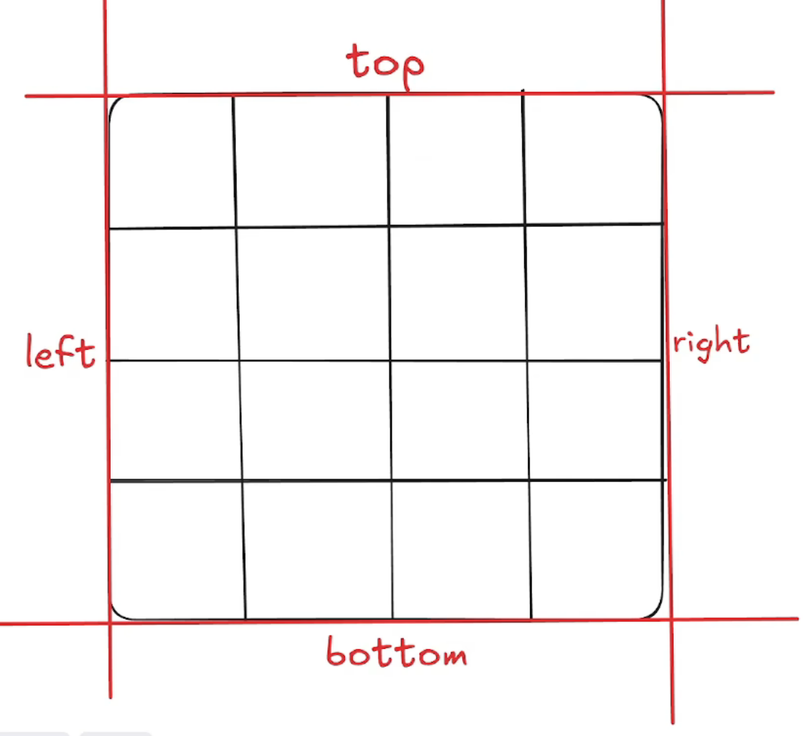
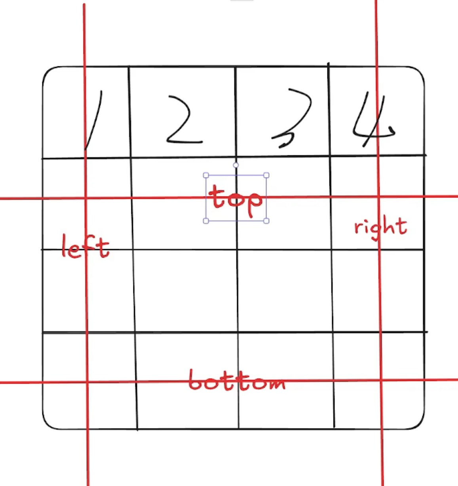
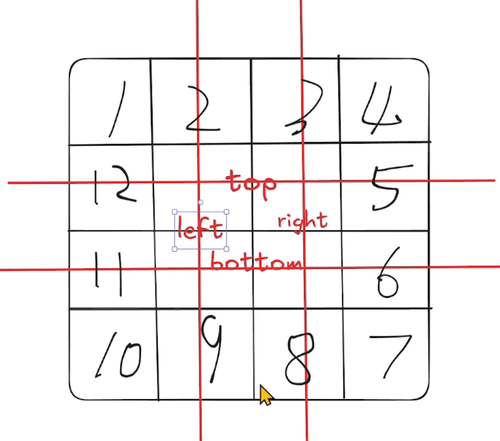

```python
class Solution:
    def generateMatrix(self, n: int) -> list[list[int]]:
        matrix = [[0] * n for _ in range(n)]             # 申请一个nxn的zeros矩阵
        count = 1                                        # 准备填入的数字从1开始的
        # 准备边界
        top, bottom = 0, n-1                             
        left, right = 0, n-1
        while count <= n**2:

            for j in range(left, right + 1):             # 左闭右开要取到第一行的第n个元素
                matrix[top][j] = count
                count += 1
            top += 1
            for i in range(top, bottom + 1):
                matrix[i][right] = count
                count += 1
            right -= 1
            # 注意边界条件
            for j in range(right, left - 1, -1):
                matrix[bottom][j] = count
                count += 1
            bottom -= 1
            for i in range(bottom, top - 1, -1):
                matrix[i][left] = count
                count += 1
            left += 1

        return matrix
```

## 贪吃蛇法

```python
DIRS = (0, 1), (1, 0), (0, -1), (-1, 0)  # 右下左上
class Solution:
    def generateMatrix(self, n: int) -> list[list[int]]:
        matrix = [[0] * n for _ in range(n)]
        i = j = di = 0
        for val in range(1, n * n + 1):  # 要填入的数
            matrix[i][j] = val
            x, y = i + DIRS[di][0], j + DIRS[di][1]  # 下一步的位置
            # 如果 (x, y) 出界或者已经填入数字
            if x < 0 or x >= n or y < 0 or y >= n or matrix[x][y]:
                di = (di + 1) % 4  # 右转 90°
            i += DIRS[di][0]
            j += DIRS[di][1]  # 走一步
        return matrix
```

# 54.螺旋矩阵
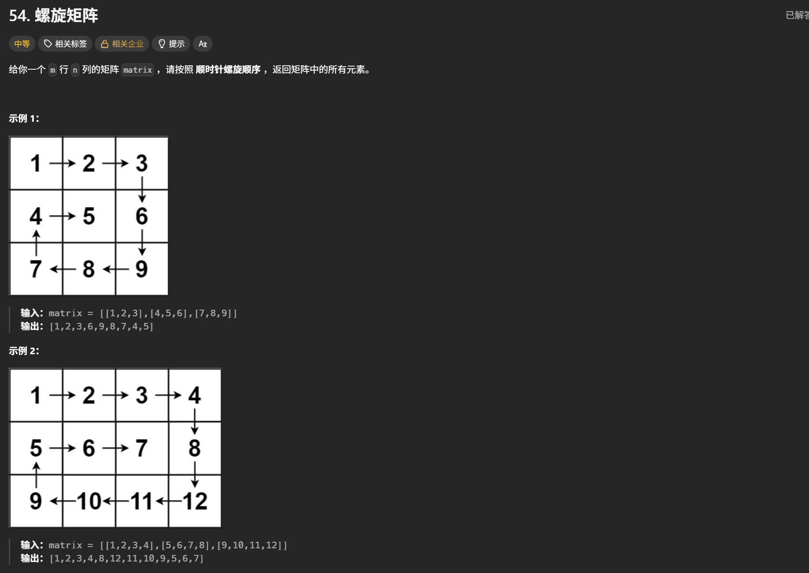
## 常规解法
```python
class Solution:
    def spiralOrder(self, matrix: list[list[int]]) -> list[int]:
        m, n = len(matrix), len(matrix[0])
        mat = [0] * m * n
        count = 0
        top, bottom = 0, m - 1
        left, right = 0, n - 1
        while count < m * n:
            for j in range(left, right + 1):
                mat[count] = matrix[top][j]
                count += 1
            top += 1 
            for i in range(top, bottom + 1):
                mat[count] =  matrix[i][right]
                count += 1
            right -= 1
            if top <= bottom:   # 如果是n*n的话总会剩下4个或者一个不存在超出索引
                for j in range(right, left - 1, -1):
                    mat[count] =  matrix[bottom][j]
                    count += 1
                bottom -= 1 
            if left <= right:   # 如果是n*n的话总会剩下4个或者一个不存在超出索引
                for i in range(bottom, top - 1, -1):
                    mat[count] =  matrix[i][left]
                    count += 1
                left += 1 
        return mat
```

## 边界收缩法
注意$\color{#ff0000}{n*n和m*n，不一样会多一个边界}$\
例如是4*3的矩阵会在第九个元素记录结束的时候上下边界会重合\
但是n*n不会

```python
class Solution:
    def spiralOrder(self, matrix: list[list[int]]) -> list[int]:
        m, n = len(matrix), len(matrix[0])
        mat = [0] * m * n
        count = 0
        top, bottom = 0, m - 1
        left, right = 0, n - 1
        while count < m * n:
            for j in range(left, right + 1):
                mat[count] = matrix[top][j]
                count += 1
            top += 1 
            for i in range(top, bottom + 1):
                mat[count] =  matrix[i][right]
                count += 1
            right -= 1
            if top <= bottom:   # 如果是n*n的话总会剩下4个或者一个不存在超出索引
                for j in range(right, left - 1, -1):
                    mat[count] =  matrix[bottom][j]
                    count += 1
                bottom -= 1 
            if left <= right:   # 如果是n*n的话总会剩下4个或者一个不存在超出索引
                for i in range(bottom, top - 1, -1):
                    mat[count] =  matrix[i][left]
                    count += 1
                left += 1 
        return mat
```

## 贪吃蛇法

```python
class Solution:
    def spiralOrder(self, matrix: list[list[int]]) -> list[int]:

        m, n = len(matrix), len(matrix[0])
        visited = [[False] * n for _ in range(m)]
        i = j = 0
        x = y = di = 0
        # 前进方向
        dirs = ((0, 1), (1, 0), (0, -1), (-1, 0))
        count = 0
        mat = [0] * m * n

        while count < m * n:

            mat[count] = matrix[i][j]
            visited[i][j] = True
            
            x = i + dirs[di][0]
            y = j + dirs[di][1]

            # 注意这题和旋转矩阵Ⅱ不同的是不用再次记录数组的内容
            # 但是要判断你遇到已读到的格子
            # 因此需要建立一个visited[x][y]里面存放True 和 False表示是否访问过
            # 注意不要认为简单就直接采用matrix[i][j] in mat 如果说有重复数据或者是又0就会产生冲突
            if x < 0 or x >= m or y < 0 or y >= n or visited[x][y]:
                di += 1
                di = di % 4 
            i += dirs[di][0]
            j += dirs[di][1]
            count += 1
            
        return mat
```

# 303.区域和检索-数组不可变
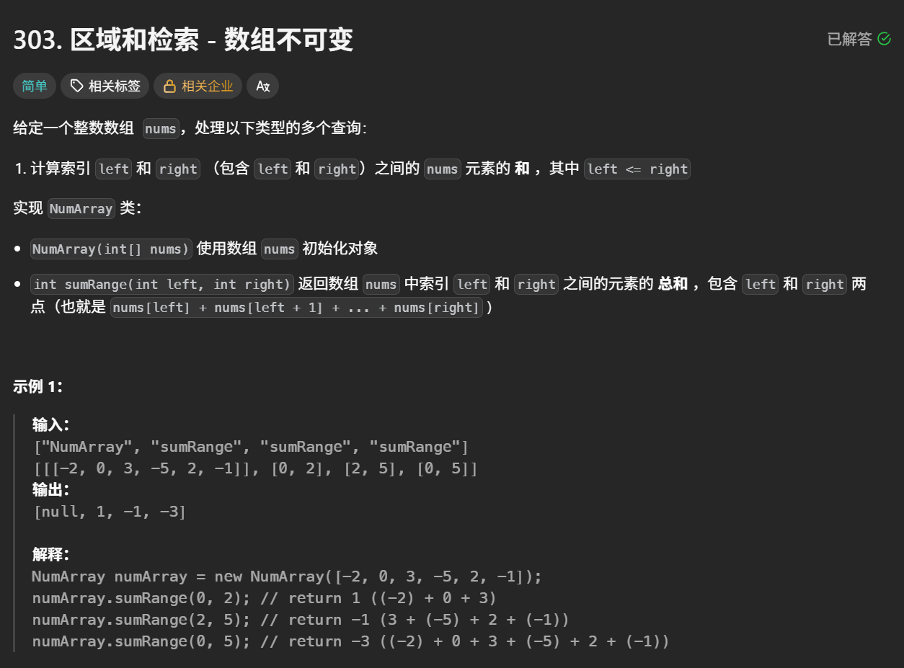

## 常规解法
这里的时间复杂度取决于left到right的长度，而且会多次调用sumRange

```python
class NumArray:

    def __init__(self, nums: list[int]):

        #初始化数组
        self.nums = nums

    def sumRange(self, left: int, right: int) -> int:

        self.my_sum = 0
        for i in range(left, right + 1): # 要求包含下标的数
            self.my_sum += self.nums[i]
            
        return self.my_sum
```

## 我的解法（邪修版前缀和）
这个其实有点小问题，由于我的前缀和的元素数量和原始数组元素数量$\color{#ff0000}{相同}$\
这个就会导致$\color{#ff0000}{边界问题}$\
当在计算(0,2)这种边界，由于前缀和的元素数量和原始数组元素数量相同，你在做差时容易把$\color{#ff0000}{第一位}$减去结果错误

```python
class NumArray:

    def __init__(self, nums: list[int]):
        self.nums = nums
        self.Sum = 0
        # 其实这里没必要用哈希表
        # 因为最后采用的索引方式时下标索引
        # 因此你用list和dict是一样的效果
        # 用dict反而会稍微加大一点空间复杂度
        self.preSum = {} 

        for i, item in enumerate(nums):
            self.Sum += item
            self.preSum[i] = self.Sum

    def sumRange(self, left: int, right: int) -> int:
        
        # 注意扣边界条件，做补丁
        if left == 0:
            return self.preSum[right]
        # 最后返回的索引下表 S_n - S_n-2 = a_n + a_n-1, 所以是 right 对应的值减去left - 1 对应的值
        return self.preSum[right] - self.preSum[left - 1] 
```

## 前缀和

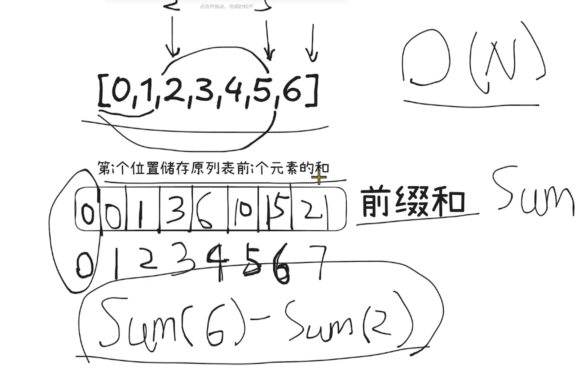

```python
class NumArray:

    def __init__(self, nums: list[int]):

        # 初试化数组
        self.nums = nums
        self.preSum = [0] * (len(nums) + 1)

        # 创建前缀和
        for i in range(len(nums)):
            self.preSum[i + 1] = self.preSum[i] + nums[i]

    def sumRange(self, left: int, right: int) -> int:
        
        # 需要注意的是右加一是因为第一位空位了
        return self.preSum[right + 1] - self.preSum[left]
    
```

# 560.和为K的子数组

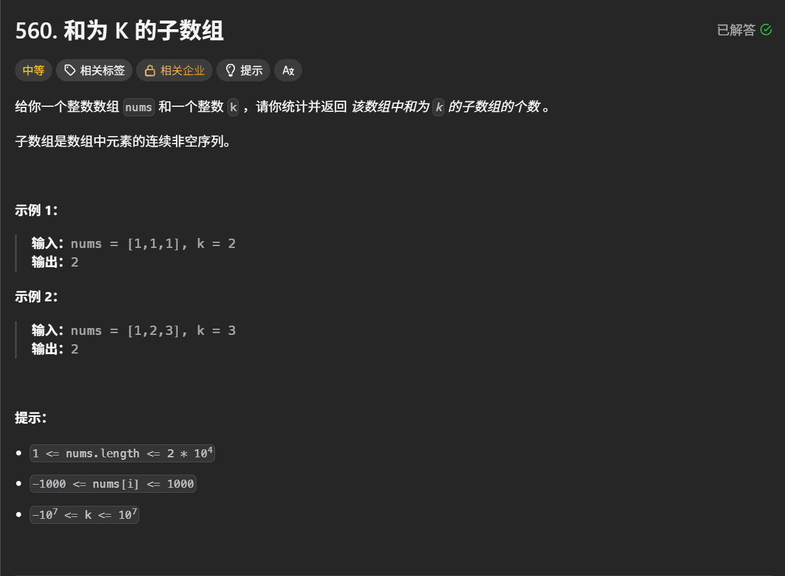

## $\color{#ff0000}{错误解法}$

滑动指针其实是错误的\
为什么之前的滑动指针是正确的呢？\
之前的题目中说了$\color{#ff0000}{正整数}$，由于你中间利用了my_sum >= k，就必须要保证是单调的\
因此是不能够使用滑动指针的\
数组必须$\color{#ff0000}{单调}$才能使用

```python
class Solution:
    def subarraySum(self, nums: list[int], k: int) -> int:
        left = 0
        right = 0
        my_sum = 0
        count = 0 
        while right < len(nums):

            my_sum += nums[right]
            while my_sum >= k and left < len(nums):
                    if my_sum == k:
                        count += 1
                    my_sum -= nums[left]
                    left += 1 
            right += 1

        return count
    
```

## 正确解法 前缀和+哈希表

以后看到子数组和就要想到前缀和滑动窗口\
如果是$\color{#ff0000}{单调数组}$直接滑动窗口\
如果只是普通数组无脑前缀和然后再通过别的方法去完成任务\
当你得到前缀和这个数组时不就梦回第一题两数之和了吗\
需要在一个数组里面找到两个数之差为k，当然由于你是前缀和因此时要有左右顺序的

```python
class Solution:
    def subarraySum(self, nums: list[int], k: int) -> int:

        preSum = [0] * (len(nums) + 1)
        for i in range(len(nums)):
            preSum[i + 1] = preSum[i] + nums[i]

        cache = {}  # 记录的是每个 item 出现的次数，而不是之前的下标索引，这里是和两数之和不同的地方
        count = 0
        
        for i, item in enumerate(preSum):

            # 这边要自己理清楚这个逻辑
            # 由于你是后保存的cache，因此你other的数据一定是已经记录的
            # 换而言之就是前缀和中靠左边的元素
            # 根据要求子数组的和为k 不就是preSum(右) - preSum(左) 即 item - other = k
            other = item - k

            if other in cache:
                # 因此这里count理应加的不是1而是other，也就是要找到的另外一个前缀和出现的次数
                count += cache[other]

            # 因为你不是单调的所以对于当前这个 item 会出现很多次重复的item
            # 因此cache记录的是每个 item 出现的次数
            # 通过cache.get(item, 0)取出对应的key值，如果没有就赋值为0再加一赋值回去，如果存在就直接拿出来加一
            cache[item] = cache.get(item, 0) + 1

        return count
```

## 更简单的写法(与上一个方法原理相同只不过用一个for循环快一点)

```python
class Solution:
    def subarraySum(self, nums: List[int], k: int) -> int:
        
        cache = defaultdict(int)     # cache = defaultdict(int) 会把不存在的key值对应的val写为0
        cache[0] = 1                 # 注意前缀和要要比正常是数组多以为要自己补充 s[0]=0 单独统计
        count = preSum = 0
        
        for item in nums:
            
            preSum += item

            # 这里注意没有判断是否preSum - k存在与cache中
            # 一般来讲key不存在会报错
            # 单数上面初始化的时候不是cache = {} 而是 cache = defaultdict(int)
            # 会把不存在的key值对应的val写为0
            count += cache[preSum - k] 
            cache[preSum] += 1
        
        return count
```

# 1109.航班预定统计

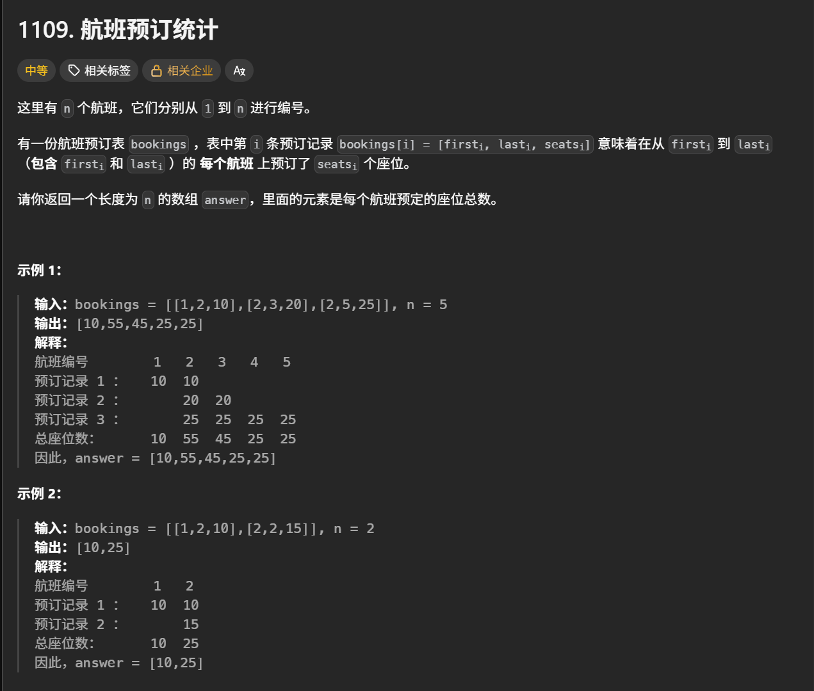

## 暴力求解$\color{#ff0000}{O(MN)}$
```python
class Solution:
    def corpFlightBookings(self, bookings: list[list[int]], n: int) -> list[int]:
        
        answer = [0] * n

        for first, last, seats in bookings:

            for i in range(first - 1, last):
                answer[i] += seats
        
        return answer
```

## 差分数组$\color{#ff0000}{O(M+N)}$

可以类比于$\color{#ff0000}{公交车问题}$\
某公交车共有$n$站，第$i$条记录$bookings[i] = [i,j,k]$表示在i站上车$k$人，乘坐到$j$站，在$j+1$站下车，需要按照车站顺序返回每一站车上的人数
差分法和暴力求解有什么$\color{#ff0000}{不同}$？\
主要是记录数据的方式不同，在暴力求解中我每次记录answer时都要去读取一次到底从$first$到$last$增添或者减少了多少因此时间复杂度是$O(MN)$\
但是我通过保存这个增添或者减少的量为一个新的数组最后只需要遍历一次这个数组就可得到answer\
因此时间复杂度是$O(M+N)$，空间复杂度是$O(N)$
那么什么时候采用差分数组呢？\
需要对一个数组的元素的值$\color{#ff0000}{连续增加或者减少相同的值}$

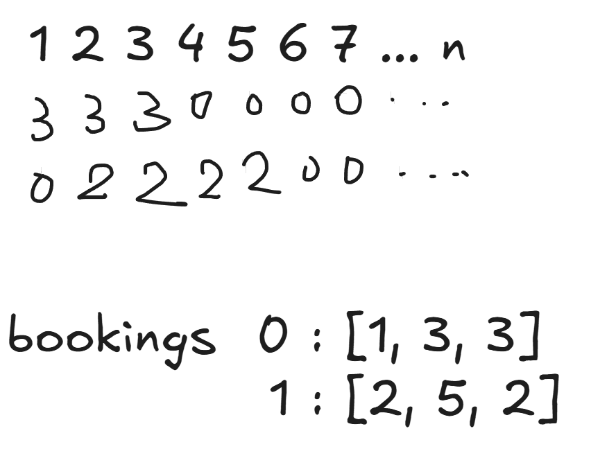

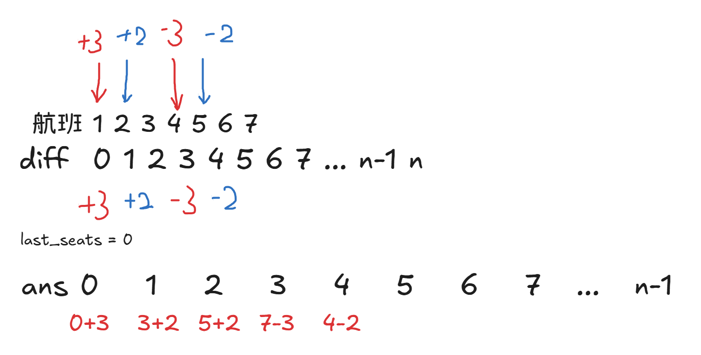

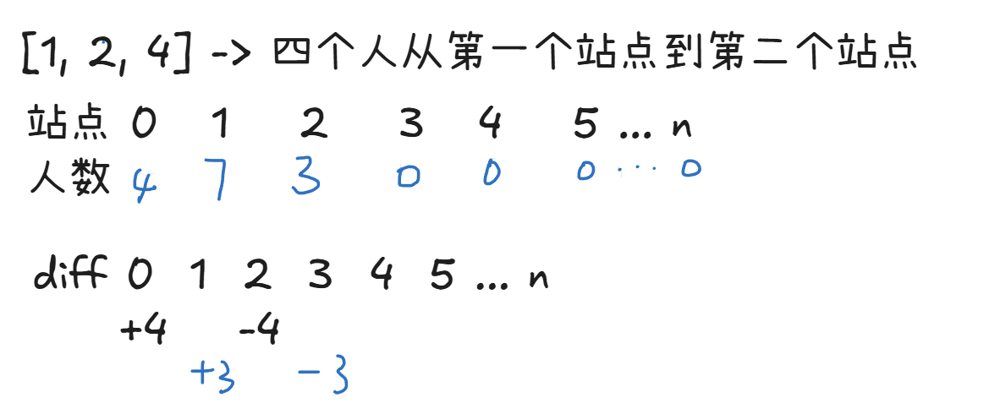

```python
class Solution:
    def corpFlightBookings(self, bookings: list[list[int]], n: int) -> list[int]:

        # 构造差分数组 维度 (n + 1) 是由于题目要求的fist，last是从1...n 而要求的 answer 是 n 
        # 如果 diff 不是 (n + 1) 会 out of index
        diff = [0] * (n + 1)  

        for first, last, seats in bookings:
            # 记录差分数组
            diff[first - 1] += seats
            diff[last] -= seats
        
        answer = [0] * n
        last_seats = 0

        for i in range(n):
            # 通过差分数组构造answer
            answer[i] = last_seats + diff[i]
            last_seats = answer[i]
        
        return answer
```

# 56.合并区间

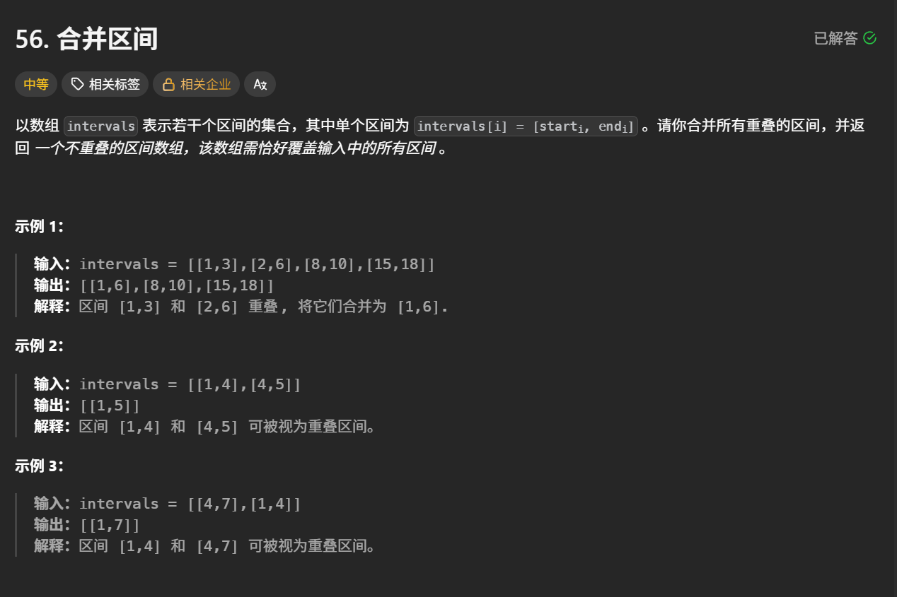

遇到合并区间问题首先看区间的排列方式师傅是从大到小\
如果不是就需要你按照每个区间的左端去排序从小到大\
之后就可以进行合并了

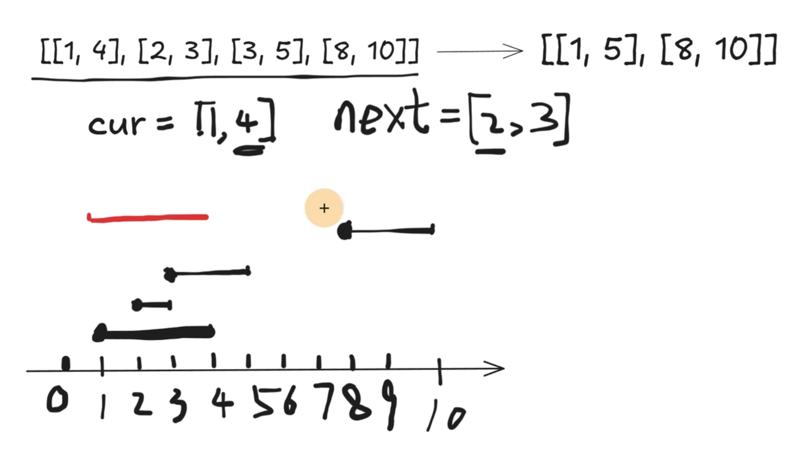
其实这个cur 和 next 的思想也有点像快慢指针的思想，只不过此时两个变量存储的是数组不是索引遍号

## 我的解法(所见即所得，但是打了很多补丁，已然成屎山)

```python
class Solution:
    def merge(self, intervals: list[list[int]]) -> list[list[int]]:

        # sort方法是list排序中常用的
        # key需要传入的是一个函数，即你排序的标准是什么
        # 后面还有一个关键词reverse默认是False，意思从小到大排序，True反之
        intervals.sort(key=lambda x: x[0])
        # 注意初始化，如果在for循环里面初始化会每次吧cur初始化的
        cur = intervals[0]
        ans = []

        for i in range(len(intervals) - 1):

            Next = intervals[i + 1]
            # 判断当前是否重合，重合就一直合并
            if cur[1] >=  Next[0] :
                cur = [cur[0], max(cur[1], Next[1])]     
            else:
                # 一旦不重合就返回答案，并且更新cur
                ans.append(cur)
                cur = Next
        # 这也是一个补丁，是因为循环range(len(intervals) - 1)
        # 因此你在最后循环的最后一个cur并未记录，因此需要你单独在循环外记录一次
        ans.append(cur)
        
        return ans
```

## 更加优雅的解法
```python
class Solution:
    def merge(self, intervals: list[list[int]]) -> list[list[int]]:
        
        intervals.sort(key=lambda x: x[0])  # 按照左端点从小到大排序

        ans = []

        for x in intervals:

            if ans and x[0] <= ans[-1][1]:  # 左端点在合并区间内，可以合并
                ans[-1][1] = max(ans[-1][1], x[1])  # 更新合并区间的右端点
            else:  # 不相交，无法合并
                ans.append(x)  # 新的合并区间
        
        return ans
```

# 41.缺失的第一个正数

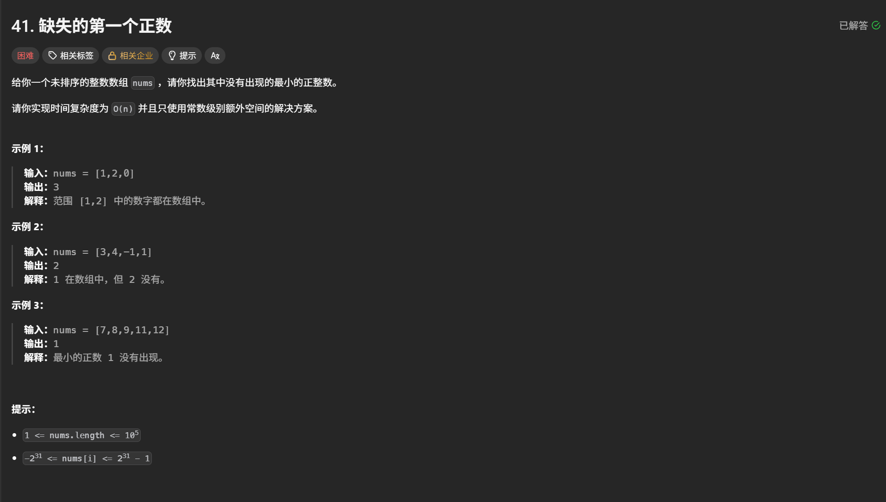

## 错误解法

看到这个题目提到$\color{#ff0000}{对一个数组进行操作并且时间复杂度是O(N)}$就要想到要使用哈希表

```python
class Solution:
    def firstMissingPositive(self, nums: list[int]) -> int:
        
        nums_set = set(nums)  # 其实set的底层数据结构也是哈希表
        count = 1

        while True:

            if not count in nums_set:
                return count     

            count += 1
                
```
## 正确解法

你以为题目就这么简单吗？\
这可是困难题，题目要求后面还有一句话就是使用常熟级别的空间复杂度\
我们知道哈希表是用空间换时间，因此哈希表的时间复杂度是O(N)，但是空间复杂度也是O(N)\
如果我们需要哈希表的映射关系，同时又想直接操作这个数组本身，这样时间复杂度就是O(N)，空间复杂度就是常数级别
提出一个新概念$\color{#ff0000}{归位}$\
当一个数组的值比其下标大一时我们称这个数组归位了\
比如：数组[1, 2, 3, 4, 5] 每个元素对应的下表依次是 0, 1, 2, 3, 4
其实这里想强调的是$\color{#ff0000}{哈希表的映射关系}$，也可以不只是差一个\
也可以有很多的规则，这里只是这样做简单并且题目要求就是正整数\
这种方式可以叫做$\color{#ff0000}{原地哈希}$，也可以看$\color{#ff0000}{成换座位}$\
因此首先需要构建原地归位的自制哈希表，然后再去遍历这个哈希表

```python
class Solution:
    def firstMissingPositive(self, nums: list[int]) -> int:
        i = 0

        # 构建归位哈希
        while i < len(nums):
            num = nums[i]
            if i == num - 1:  # 当前元素已归位
                i += 1
            else:             # 对未归位元素归位
                # 并不是所有的元素都是有条件进行归为操作的
                # 如果你远比数组的长度都大归不了
                # 如果你是负数也归位不了
                # 需要补充的一点是，当遇见[1, 1]这种数组时
                # 不加num = nums[nums - 1]会一直循环
                if 1 <= nums[i] <= len(nums) and num != nums[num - 1]:
                    # 第一种交换写法
                    # target = nums[num - 1]
                    # nums[num - 1] = num
                    # nums[i] = target
                    # 第二种交换写法
                    nums[num - 1], num = num, nums[num - 1]
                else:        # 进行归位操作后
                    i += 1 
            
        # 遍历归位好的数组
        for i, item in enumerate(nums):
            if i != item - 1:
                return i + 1

        return len(nums) + 1     # 不要忘记如果最后是[1, 2, 3, 4, 5]这种正好的归为数组应该返回的是len(nums) + 1

```

更加简洁的写法

```python
class Solution:
    def firstMissingPositive(self, nums: list[int]) -> int:
        n = len(nums)
        for i in range(n):
        
            while 1 <= nums[i] <= n and nums[nums[i] - 1] != nums[i]:
                
                # 如果直接写nums[i], nums[nums[i] - 1] = nums[nums[i] - 1], nums[i]
                # 1000000000000000000000%会报错
                j = nums[i] - 1  
                nums[i], nums[j] = nums[j], nums[i]

        for i in range(n):
            if nums[i] != i + 1:
                return i + 1

        return n + 1
```