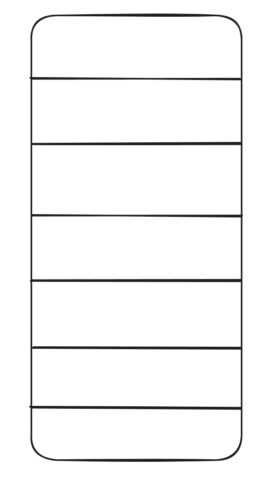
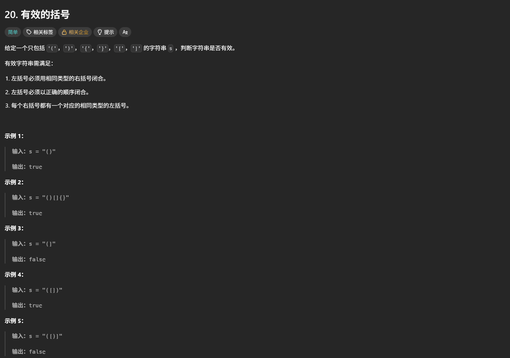
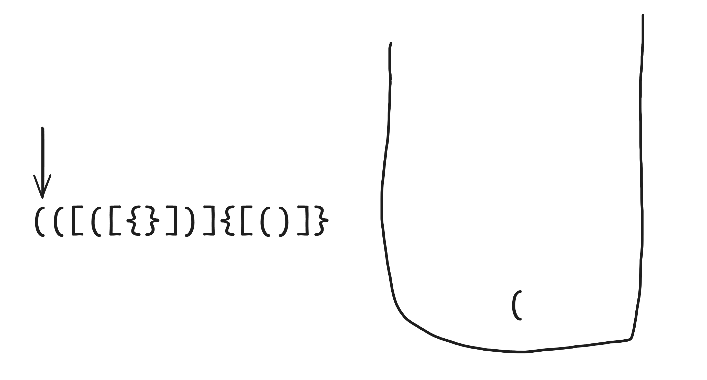
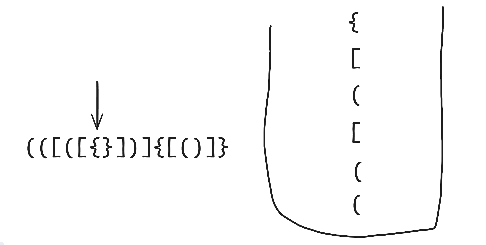
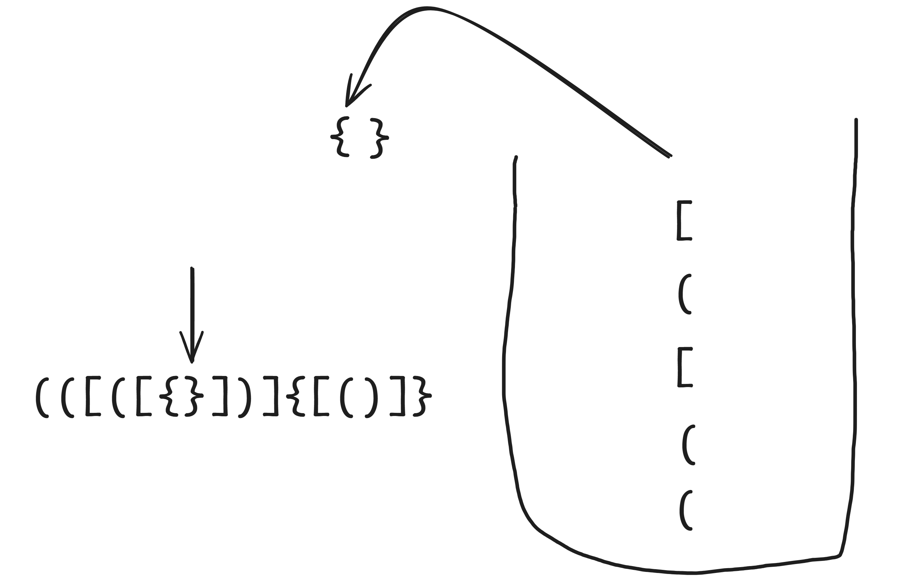
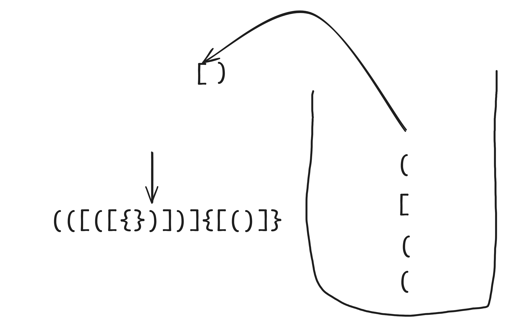
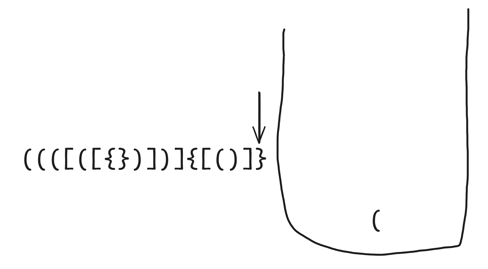

# 栈的介绍

在开始做有关于栈的题目时，首先先介绍一下栈。\
栈是一种数据结构，类似于下图这种



其中每个格子代表存放数据的空间，像是堆盒子一样的结构\
意味着它拥有的特性是每次只能对顶部的数据进行操作\
用更加专业的话术来说就是$\color{#ff0000}{先进后出}$

# 20.有效的括号



## 栈的思想$\color{#ff0000}{O(N)}$

我们先准备一个栈的空间



然后把左边括号的全部遍历完成



开始配对消去



如果遇见了不匹配的可以直接返回False了



同时当你遍历完所有的char的时候一定要检查$\color{#ff0000}{栈最后是否为空}$\
如果不是空的话，那么就证明没有被配对完成即返回False



最后还有一个问题就是如果你没有左括号那么一定就是配对不了的
具体的看代码情况

```python
class Solution:
    def isValid(self, s: str) -> bool:
        
        stack = []      # 它看起来是数组，但其实是栈空间，只不过只对该数组的最后一位元素操作而已
        cache = {')':'(', '}':'{', ']':'['}

        for char in s:

            if char in {'(', '{', '['}:   # 如果是左括号就要把数据放入栈中
                stack.append(char)
            else:                         # 如果是右括号就需要比较是不是对应的右括号
                # 如果你的栈中的元素删完了或者是本身的示例只有 '}' 
                # 记得一定要检查栈底
                if not stack:
                    return False
            # 按理来说如果要在判断就要再写至少三个 if else 但是这样做并不优雅
            # 所以我们可以初始化一个哈希表储存右括号对应的左括号
            # 方便我们快速判断是否满足消去资格
                top_element = stack.pop() # pop这个方法是把数据从数组里面拿出来因此用了这个方法之后这个数据就不存在这个数据中了
                if cache[char] != top_element:
                    return False
        
        # 一就要检查栈底防止删完配对完元素中存在栈底这种情况也是返回False
        if stack:
            return False
        else:
            return True
```

$\color{#ff0000}{那么问题来了，如何才能要想到使用栈这种数据结构呢？}$

1. 当你需要操作的数据是具有$\color{#ff0000}{对称性或者对称结构}$的时候
2. 当你需要进行$\color{#ff0000}{消消乐或者两两配对}$的思路解题时
3. 当你要现存数据时并且只对$\color{#ff0000}{数据尾部的元素}$进行操作时

双指针加栈会减少空间复杂度但是python做不出来，因为python的字符串必须转成list才能够修改

