# 栈的介绍

在开始做有关于栈的题目时，首先先介绍一下栈。\
栈是一种数据结构，类似于下图这种


其中每个格子代表存放数据的空间，像是堆盒子一样的结构\
意味着它拥有的特性是每次只能对顶部的数据进行操作\
用更加专业的话术来说就是$\color{#ff0000}{先进后出}$

# 20.有效的括号


## 栈的思想$\color{#ff0000}{O(N)}$

我们先准备一个栈的空间


然后把左边括号的全部遍历完成


开始配对消去


如果遇见了不匹配的可以直接返回False了


同时当你遍历完所有的char的时候一定要检查$\color{#ff0000}{栈最后是否为空}$\
如果不是空的话，那么就证明没有被配对完成即返回False


最后还有一个问题就是如果你没有左括号那么一定就是配对不了的
具体的看代码情况

```python
class Solution:
    def isValid(self, s: str) -> bool:
        
        stack = []      # 它看起来是数组，但其实是栈空间，只不过只对该数组的最后一位元素操作而已
        cache = {')':'(', '}':'{', ']':'['}

        for char in s:

            if char in {'(', '{', '['}:   # 如果是左括号就要把数据放入栈中
                stack.append(char)
            else:                         # 如果是右括号就需要比较是不是对应的右括号
                # 如果你的栈中的元素删完了或者是本身的示例只有 '}' 
                # 记得一定要检查栈底
                if not stack:
                    return False
            # 按理来说如果要在判断就要再写至少三个 if else 但是这样做并不优雅
            # 所以我们可以初始化一个哈希表储存右括号对应的左括号
            # 方便我们快速判断是否满足消去资格
                top_element = stack.pop() # pop这个方法是把数据从数组里面拿出来因此用了这个方法之后这个数据就不存在这个数据中了
                if cache[char] != top_element:
                    return False
        
        # 一就要检查栈底防止删完配对完元素中存在栈底这种情况也是返回False
        if stack:
            return False
        else:
            return True
```

$\color{#ff0000}{那么问题来了，如何才能要想到使用栈这种数据结构呢？}$

1. 当你需要操作的数据是具有$\color{#ff0000}{对称性或者对称结构}$的时候
2. 当你需要进行$\color{#ff0000}{消消乐或者两两配对}$的思路解题时
3. 当你要现存数据时并且只对$\color{#ff0000}{数据尾部的元素}$进行操作时

双指针加栈会减少空间复杂度但是python做不出来，因为python的字符串必须转成list才能够修改

# 739.每日温度

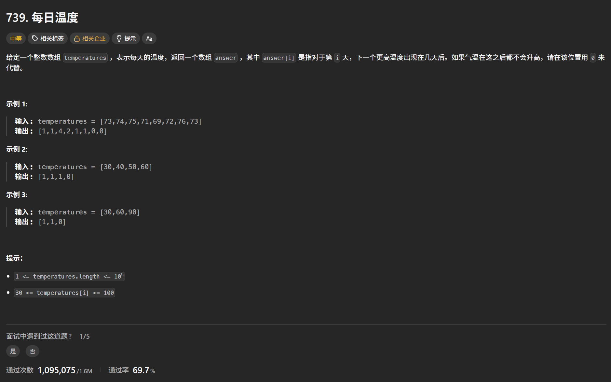

一个很自然的想法就是说直接用两个指针嵌套遍历每一个元素，然后去作比较得到答案\
但是这显然是会超时的这个做法的时间复杂度就是$O(N^2)$

## 单调栈 增援未来思想

对于这种问题能够分析出是需要之前的信息，换句话来说就是需要记忆功能，因此不难想出采用一种数据结构，通过空间换时间对于常用的数据\
结构存储方式有先入先出，先入后出等\
从先入先出的角度分析：由于存放的数据是先入先出的，因此到每到新的一天，我需要把从第一天开始的数据也要到新一天的所有温度遍历一遍\
这样会有很多重复的操作，例如[73,74,75,71,69,72,76,73], 当我在记录完74这天的答案的时候，对于75而言没必要再去和73比较了但是由于先入\
你在存或者读取数据的时候还是会对之前的元素进行操作\
从先入后出的角度分析：因为你是先入后出，你存进去的数据其实是一直没有操作的，它在等，等一个契机，这个契机就是你对栈的栈顶进行操\
作的时候，这样会省去很多重复的操作步骤，并且观察这个题目你需要把数据从小到大或者从大到小存储，因此就要考虑到采用单调栈

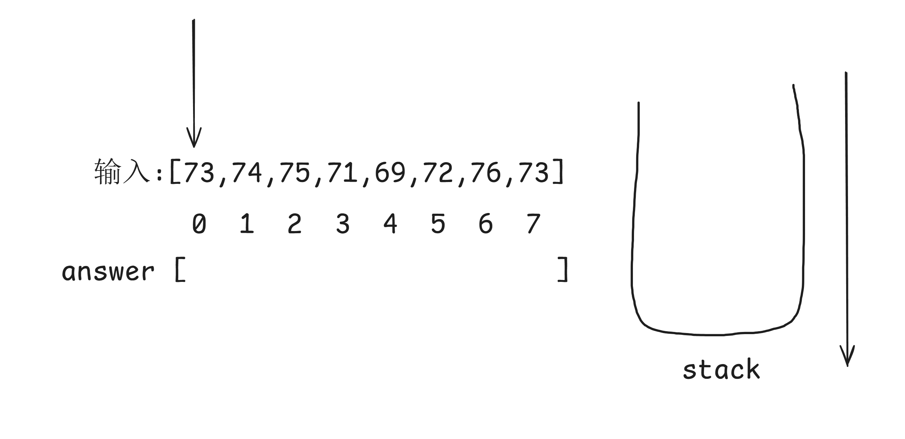

根据题目要求答案是对于当前这一天之后的温度出现在第几天之后，因此需要存储的并不是温度本身，而是温度对应的下标值

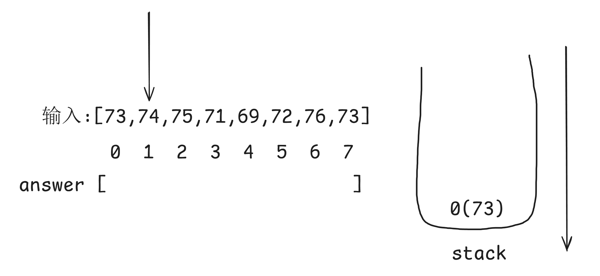

发现前面没有数据那直接压栈注意存的是下标

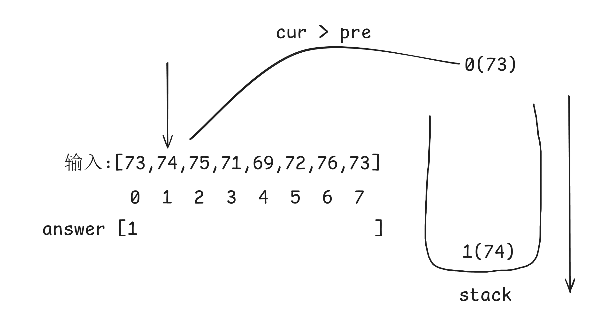

到第二个的时候要弹出栈顶开始比较如果是当前的大于栈顶的可以计算答案，这个答案就是当前的下标减去栈顶记录的下标\
也就是与下一次温度度升高相隔的天数，同时要压栈

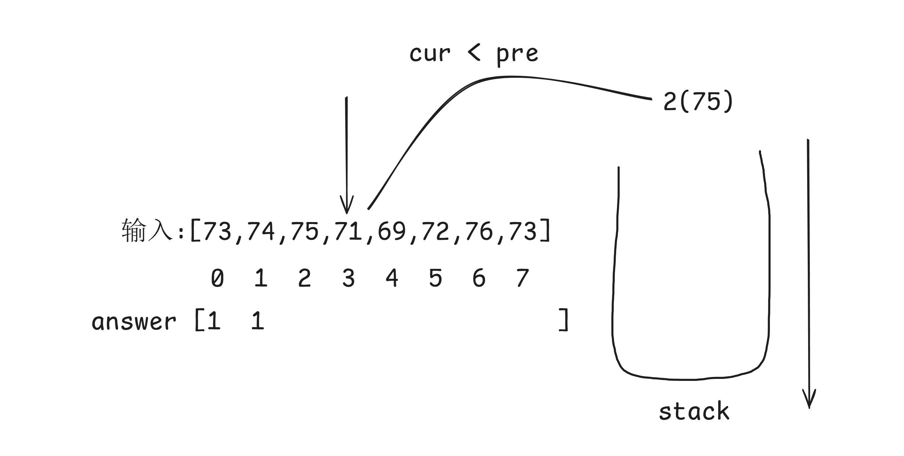

当你栈顶的对应的温度大于当前温度那么就继续压栈

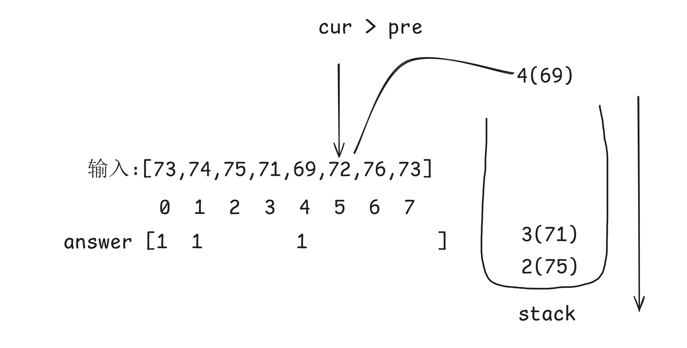

一直到当前的温度大于栈顶的温度时就要填答案了

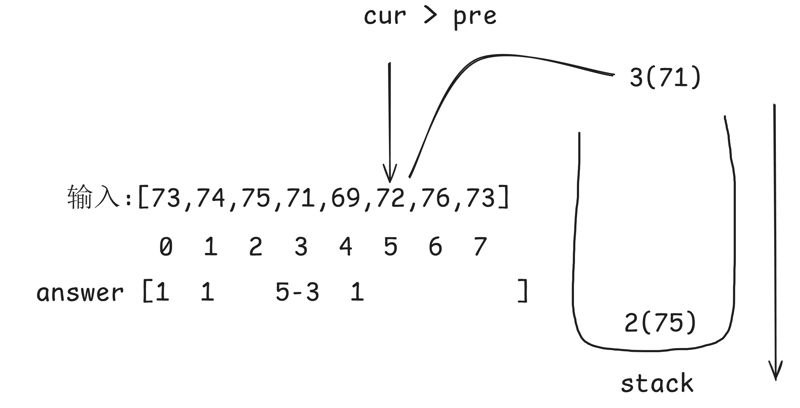

一直判断直到栈顶对应的温度再次大于当前温度那么就继续压栈

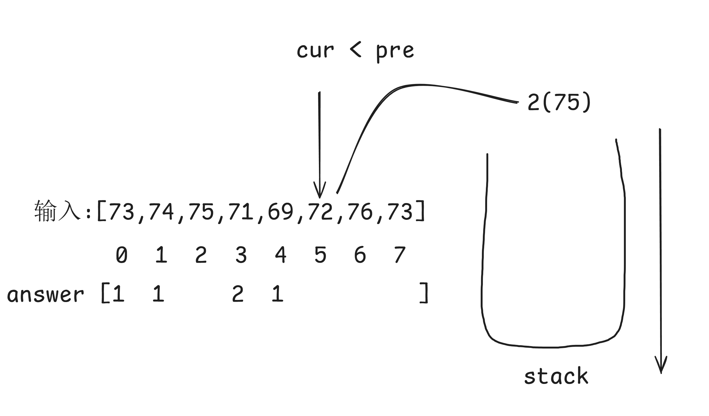

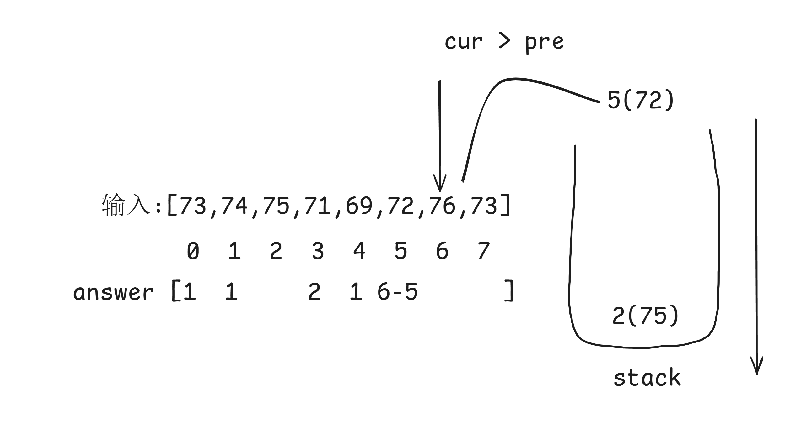

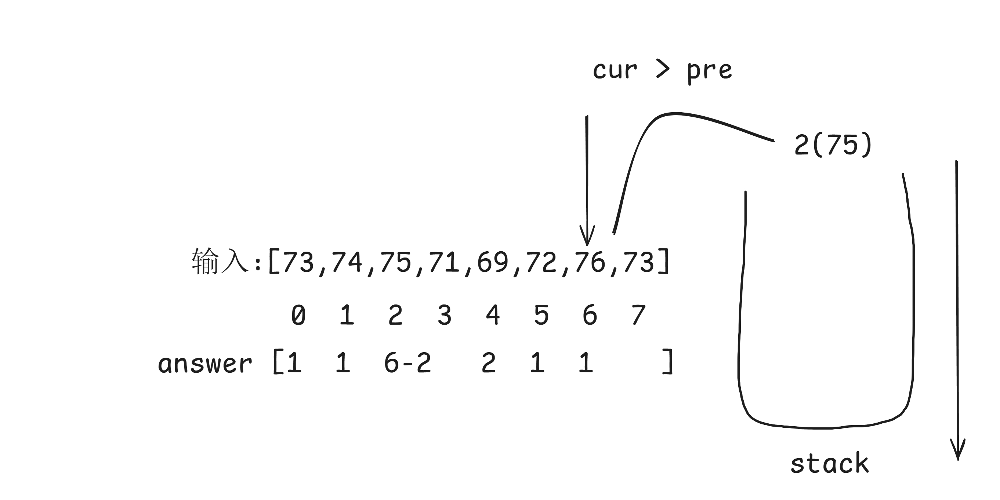

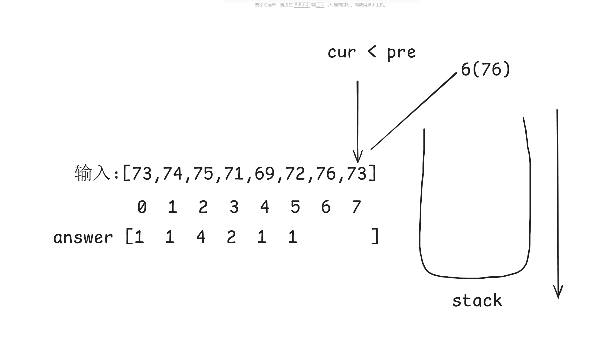

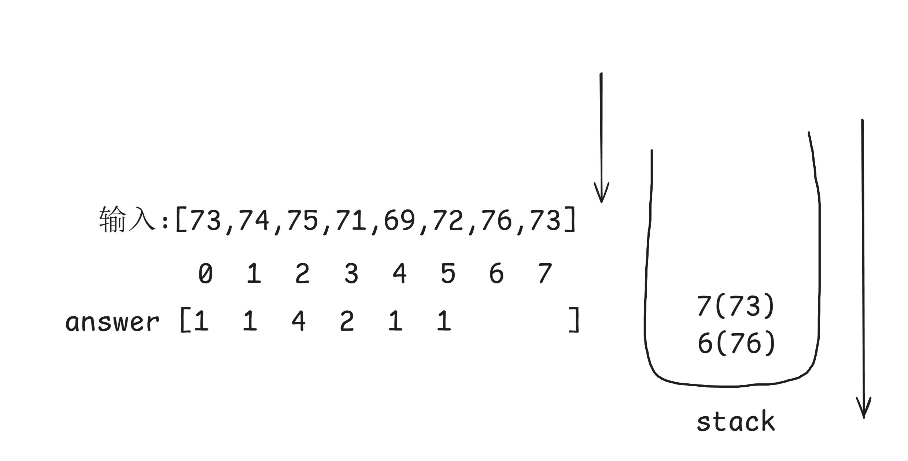

直到最后遍历玩整个温度列表剩下的默认后面没有更高的温度了，即填0

```python
class Solution:
    def dailyTemperatures(self, temperatures: list[int]) -> list[int]:
        stack = []          # 初始化一个栈
        answer = [0] * len(temperatures)
        
        # 建立一个主循环用来遍历温度
        for i in range(len(temperatures)):
            cur_temperature = temperatures[i]   # 记录当前的温度
            # # 由于在栈里面可能会存在多个需要比较的值因此还需要一个循环
            # while stack:                        # 在对栈进行操作的时候要检查是不是空
            #     # 如果当前温度大于栈顶温度
            #     if cur_temperature > temperatures[stack[-1]]:   # 需要注意的时stack里面存储的时temperature的下标
            #         pre_index = stack.pop()                     # 弹出栈顶
            #         # 这里要分清楚的时结果填写的位置是栈顶对应下标的位置，因为这个才是之前需要填的位置，也是增援未来思想的体现
            #         answer[pre_index] = i - pre_index
            #     # 如果当前温度大于栈顶温度
            #     else:
            #         break  # 如果当前温度大于栈顶温度的话就不要在循环了不然会卡死因为stack一直是非空
            # stack.append(i) # 更新栈顶，记住更新的一直是下标

            # 更简洁的写法
            while stack and cur_temperature > temperatures[stack[-1]]:
                pre_index = stack.pop()                    
                answer[pre_index] = i - pre_index

            stack.append(i)

        return answer # 直接返回answer就好因为初始化的时候是全0
```

总结：当你看到需要用过往信息并且有接下来一天比前面的大或者小这种有序问题就要想到单调栈，之所以叫单调栈，就是你在存数据的时候是有序\
总是从大到小或者从小到大