# **206.反转链表**

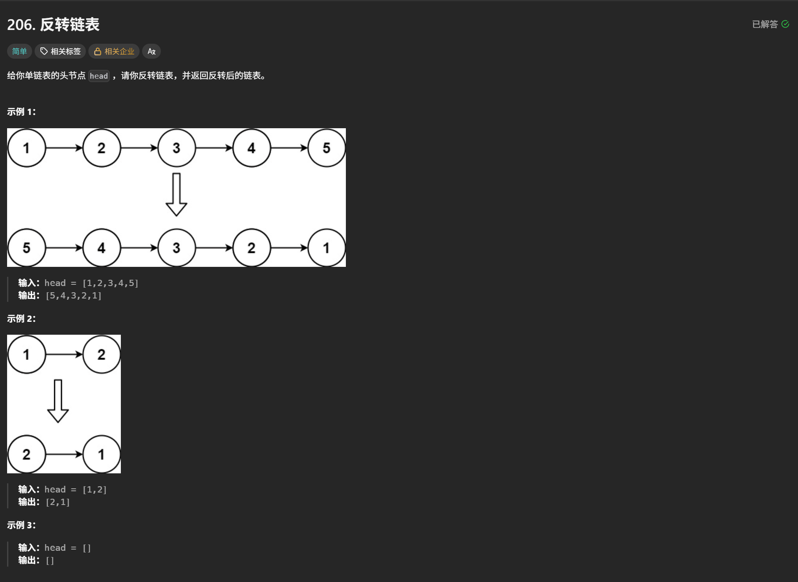

## 常规遍历法(空间复杂度$\color{#ff0000}{O(N)}$)

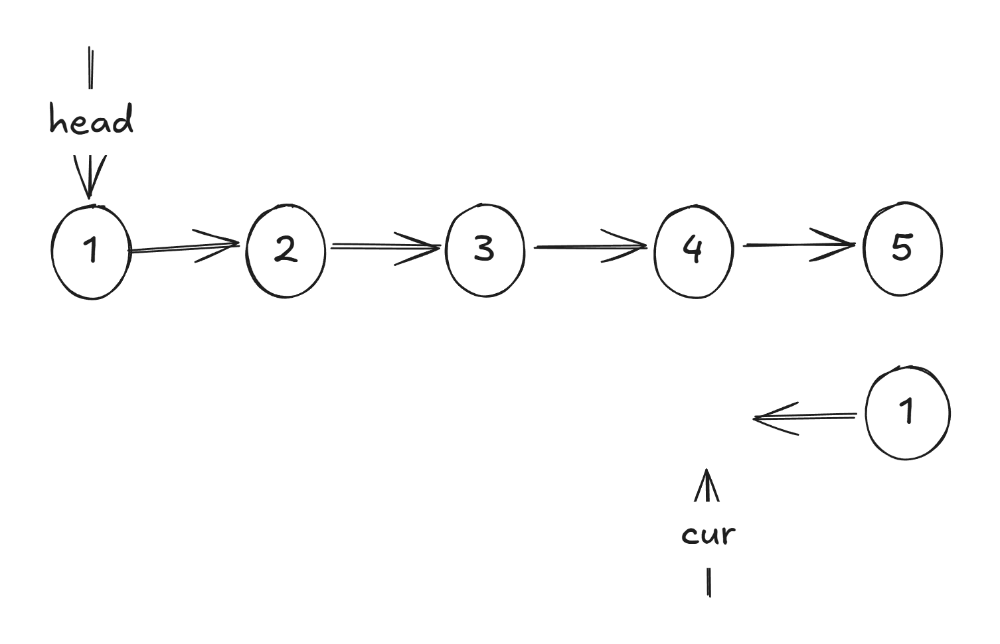

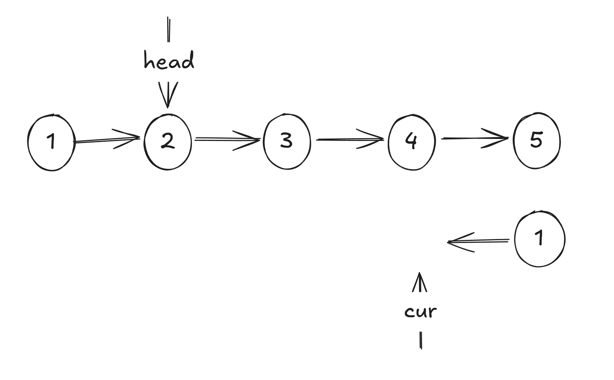

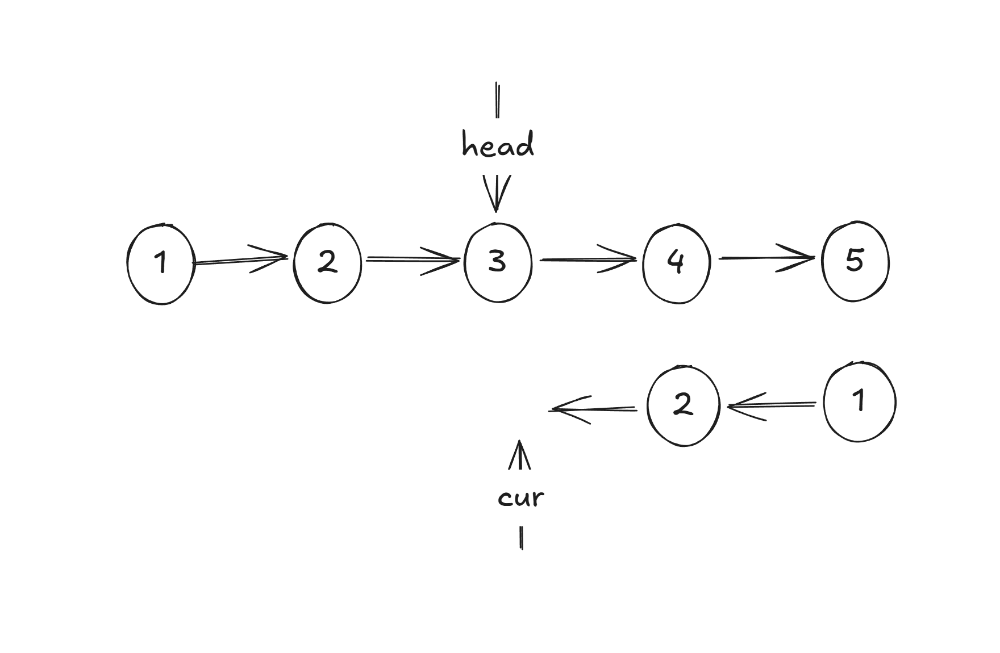

```python
class Solution:
    def reverseList(self, head: ListNode | None) -> ListNode | None:
        
        cur = None  
        
        while head != None:
            
            cur = ListNode(head.val, cur)   # 创建一个单链表 其值是head 的值，指向的是cur
            head = head.next                # 把head指针移到下一个head

        return cur
```

## 常规遍历法2(空间复杂度$\color{#ff0000}{O(1)}$)

要想空间复杂度为常数复杂度就需要原地操作这个链表\
因此原地直接取反

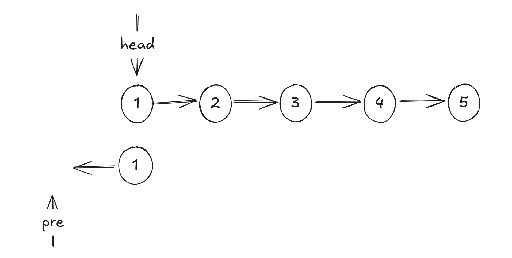

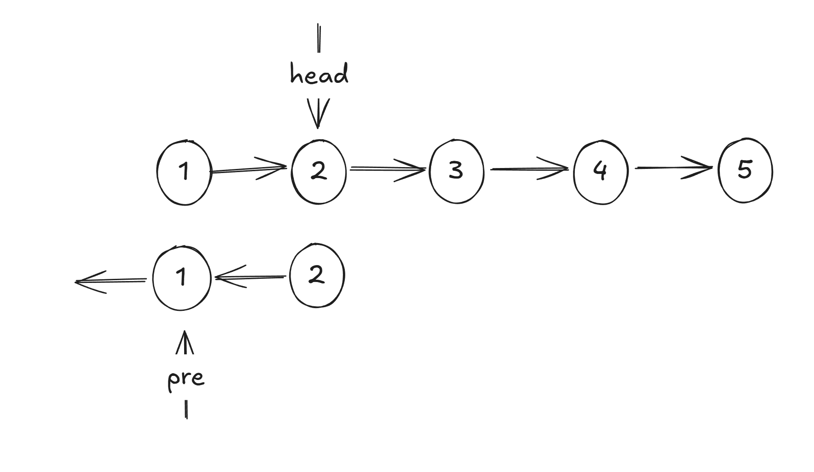

```python
class Solution:
    def reverseList(self, head: ListNode | None) -> ListNode | None:
        
        pre = None  
        
        while head != None:
            
            next_node = head.next # 创建一个中间值记录head.next 防止其丢失
            head.next = pre       # head指向pre，相当于指针反转指向后边

            pre = head            # 更新pre
            head = next_node      # 更新head
            
        return pre
```

## 递归解法

```python
class Solution:
    # 首先「递」到链表末尾，把末尾节点作为新链表的头节点 rev_head
    # 然后在「归」的过程中，把经过的节点依次插在新链表的末尾（尾插法）
    def reverseList(self, head: Optional[ListNode]) -> Optional[ListNode]:
        # 判断 head is None 是为了兼容一开始链表就是空的情况
        if head is None or head.next is None:
            return head  # 链表末尾，即下面的 rev_head
        rev_head = self.reverseList(head.next)  # 「递」到链表末尾，拿到新链表的头节点
        tail = head.next  # 在「归」的过程中，head.next 就是新链表的末尾
        tail.next = head  # 把 head 插在新链表的末尾
        head.next = None  # 如果不写这行，新链表的末尾两个节点成环，这俩节点互相指向对方
        return rev_head
        
```

# **21.合并两个有序链表**

## 常规遍历法

这次的题目需要用到虚拟链表\
改链表值为0并且指向空\
如果链表的题目有要求对链表的开头进行操作时就要想到这个方法\
或者是当你需要对链表进行初始化的时候就要想起\
这样会减少很多细节错误

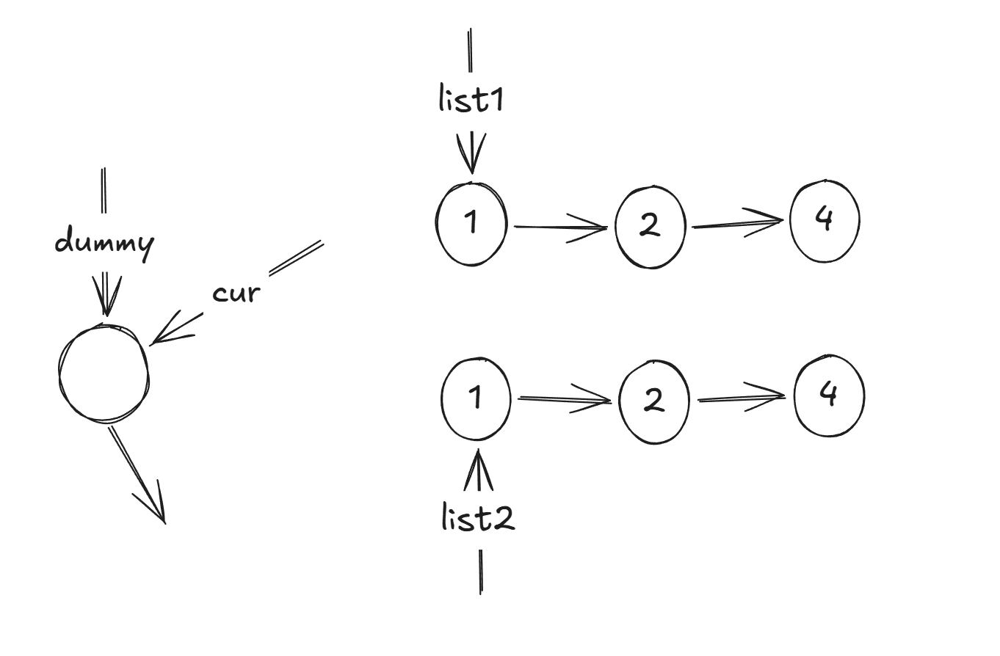

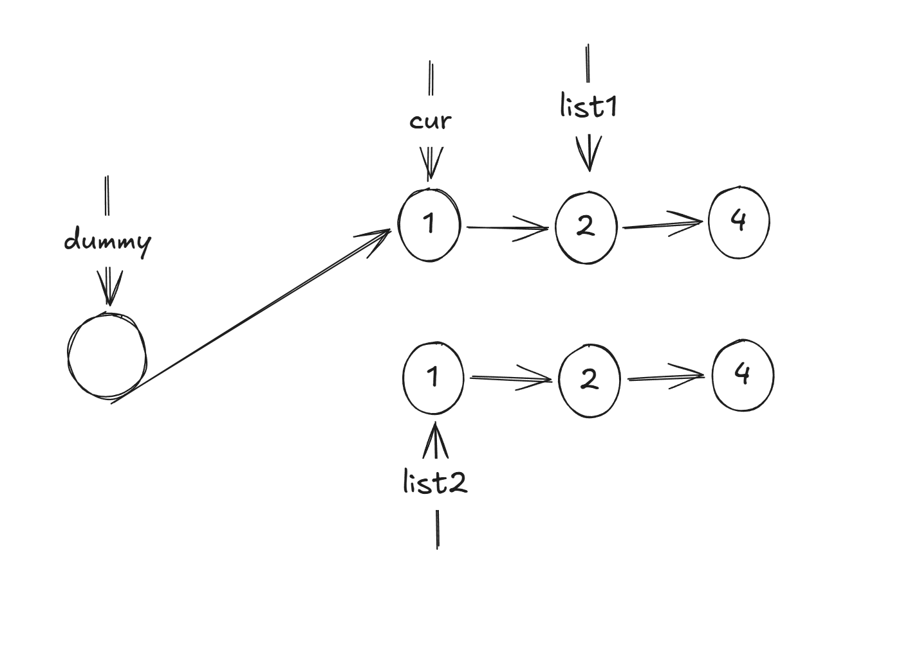

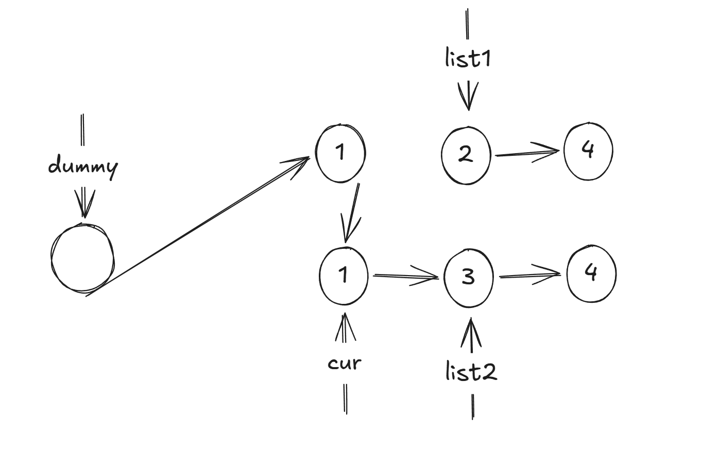

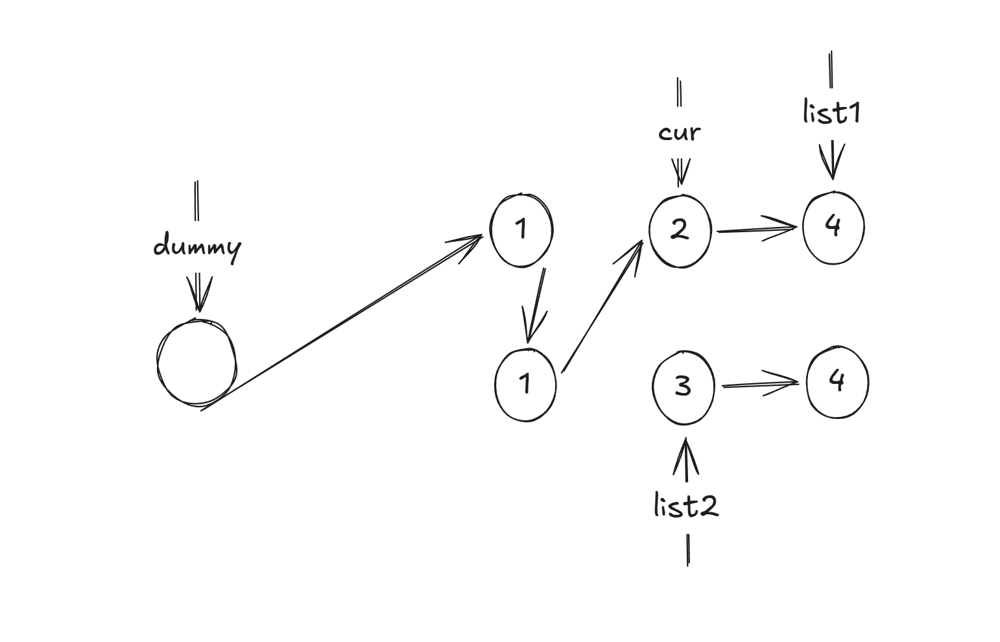

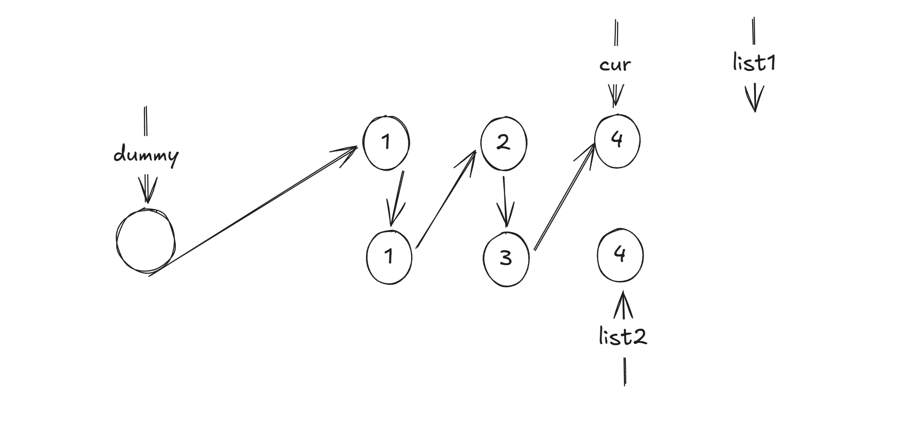


```python
class Solution:
    def mergeTwoLists(self, list1: ListNode | None, list2: ListNode | None) -> ListNode | None:
        
        dummy = ListNode()  # 初始化一个虚拟链表 val = 0 next = None
        cur = dummy         # 让cur指向dummy

        while list1 and list2:          # 循环的条件是list1和list2都不为None 

            if list1.val <= list2.val:  # 如果list1的值小于list2的值
                cur.next = list1
                list1 = list1.next     
            else:                       # 如果list1的值大于list2的值
                cur.next = list2
                list2 = list2.next

            cur = cur.next                  # 更新cur
        
        # 你不管从谁开始最后一个都会有一个指向空
        if list1 == None:
            cur.next = list2
        else:
            cur.next = list1

        return dummy.next # 为什么返回是dummy.next是因为你前一个是0

```

## 递归解法

```python
class Solution:
    def mergeTwoLists(self, list1: Optional[ListNode], list2: Optional[ListNode]) -> Optional[ListNode]:

        if list1 is None: return list2  # 注：如果都为空则返回空
        if list2 is None: return list1
        
        if list1.val < list2.val:
            list1.next = self.mergeTwoLists(list1.next, list2)
            return list1
        list2.next = self.mergeTwoLists(list1, list2.next)
        return list2

```

# **141.环形链表**

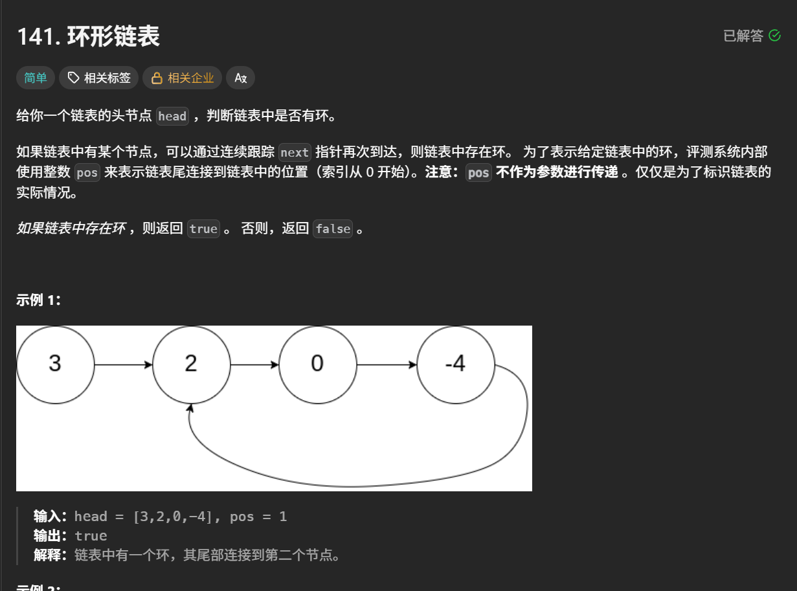

## 常规方法(空间复杂度为$\color{#ff0000}{O(N)}$)

从分析题目来看很容易想到一个方法就是哈希表\
我先遍历一遍整个链表在记下来如果有重复的不就是环形吗

```python
class Solution:
    def hasCycle(self, head: Optional[ListNode]) -> bool:

        head_set = set()

        while head:

            if head in head_set:
                retrue True

            head_set.add(head)
            head = head.next

        return False  
```

## Floyd 快慢指针(空间复杂度为$\color{#ff0000}{O(1)}$)

想象一下龟兔赛跑的故事\
如果是在一个环形操场上兔子跑的快\
乌龟跑的慢，因此兔子总会再次与乌龟相遇\
因此我们需要创建一个快慢指针\
即快指针会再次与慢指针相遇\
如果相遇就代表了存在环形

```python
class Solution:
    def hasCycle(self, head: Optional[ListNode]) -> bool:

        # 初始化快慢指针
        slow = head
        fast = head

        # 这个while循环条件与之前不同的原因是fast每次前进两次
        # 为了防止fast.next.next不存在
        while fast and fast.next:  

            slow = slow.next
            fast = fast.next.next

            if slow == fast:
                return True

        return False  
```

下次一遇见环形链表第一时间就要想起
$\color{#ff0000}{Floyd 快慢指针}$

# **142.环形链表Ⅱ**

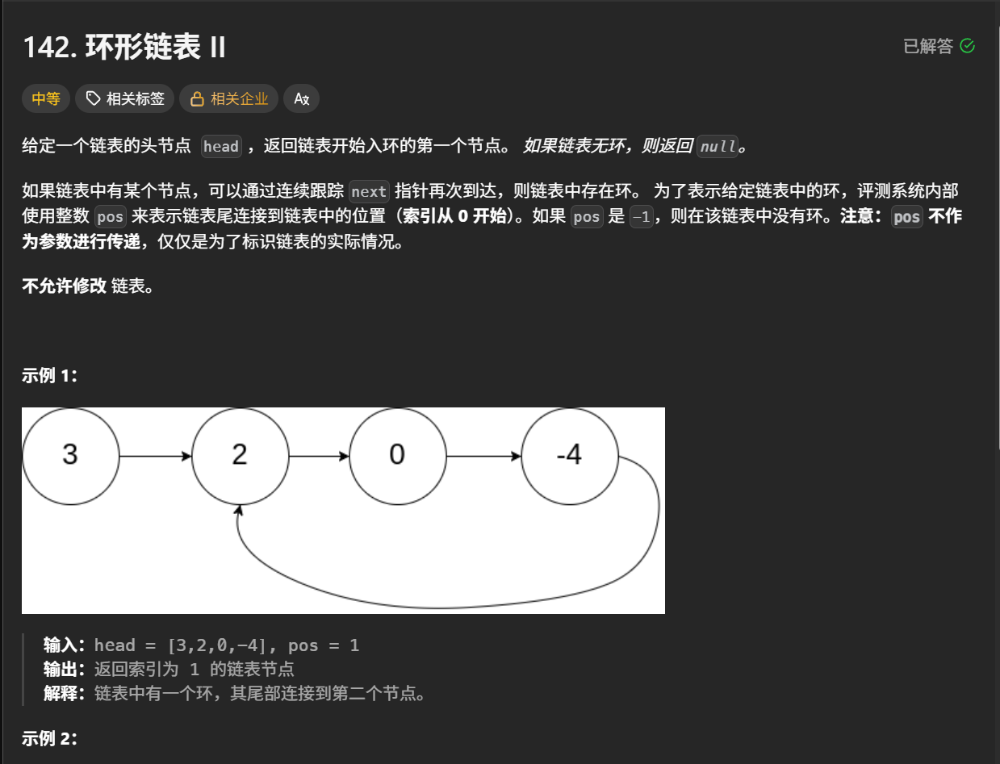

## 常规方法(空间复杂度为$\color{#ff0000}{O(N)}$) 面试60分答案

从分析题目来看很容易想到一个方法就是哈希表\
我先遍历一遍整个链表在记下来，然后把重复的起点输出就好

```python
class Solution:
    def detectCycle(self, head: Optional[ListNode]) -> Optional[ListNode]:

        head_set = set()

        while head:

            if head in head_set:
                retrue head

            head_set.add(head)
            head = head.next

        return False  
```

## Floyd 快慢指针(空间复杂度为$\color{#ff0000}{O(1)}$)

从141题我们知道了通过快慢指针能够判断出是否存在环形\
但是此题需要解决的问题是在哪重复的\
我们画图来分析一下

通过画图不难分析出如果是fast 比 slow 每次多走1步 fast 和 slow总会在重复的前一刻相遇

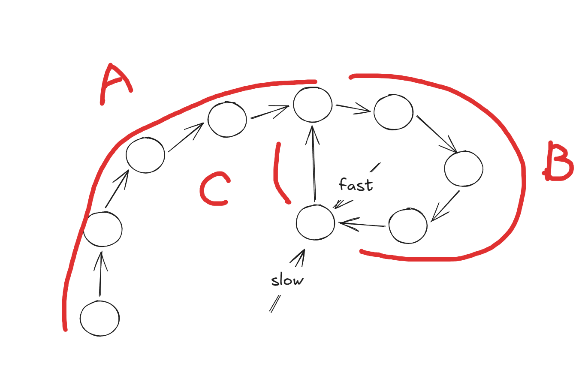

现在根据图片和速度关系可以列出
慢指针slow走过的距离 A + B \
快指针fast走过的距离 A + B + n(B + C)\
则有
$$
2(A+B) = n(b+c) + A + B
$$
化简可以得到
$$
A = (n - 1)(B + C) + C
$$

要如何理解这个方程呢？

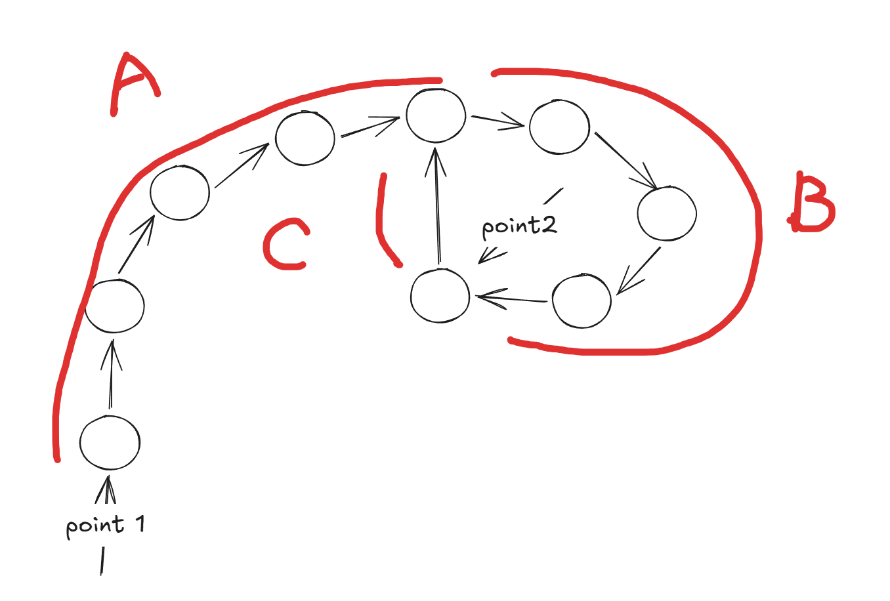

根据这个图我们可以新建立两个指针为point1和point2\
我们把point1放在开头把point2放在刚刚两个指针相遇的位置\
那么这个方程就可以理解为point1从链表开头一直走到环形开头\
同时point2一直在环形里面循环直到再次相遇\
这次相遇的地方就是环形开始的地方

```python
class Solution:
    def detectCycle(self, head: Optional[ListNode]) -> Optional[ListNode]:

        # 初始化快慢指针
        slow = head
        fast = head

        # 这个while循环条件与之前不同的原因是fast每次前进两次
        # 为了防止fast.next.next不存在
        while fast and fast.next:  

            slow = slow.next
            fast = fast.next.next

            if slow == fast:     # 判断是否有环形
                # 初始化两个新的指针一个在开头一个此刻相遇的地方
                point1 = head
                point2 = fast

                # 当point1 == point2的时候
                # 就找到环形的开头，即可跳出循环
                while point1 != point2:
                    
                    point1 = point1.next
                    point2 = point2.next

                return point1
                
        return None  
```